# Laporan Praktikum Sistem Terdistribusi dan Terdesentralisasi

## Pertemuan 03: Sinkronisasi pada Sistem Terdistribusi

### Identitas

- Nama: **Diana Amelia**
- NIM: **255410042**
- Kelas: **Informatika-1**

## 1. Tujuan

1. Memahami pentingnya sinkronisasi waktu pada sistem terdistribusi.
2. Menjelaskan proses sinkronisasi waktu menggunakan NTP dan NetTime.
3. Memahami vector clock untuk menentukan hubungan kausalitas antar-event.
4. Mengamati ketidakpastian urutan eksekusi pada program multithreaded.
5. Menjelaskan data race dan pencegahannya menggunakan lock.
6. Menjelaskan penyebab deadlock serta cara menghindarinya.
7. Memahami proses pemilihan leader menggunakan algoritma Raft.
8. Membuat modul Python dan contoh simulasi vector clock serta Raft.

## 2. Dasar Teori

### 2.1 Sinkronisasi Waktu

Sinkronisasi waktu adalah proses menyamakan referensi waktu pada beberapa
komputer atau node. Waktu yang konsisten diperlukan untuk pencatatan log,
timestamp, pengurutan kejadian, dan koordinasi antar-node.

Network Time Protocol (NTP) menyinkronkan waktu client dengan server waktu
melalui jaringan. Client mengirim permintaan, menerima waktu server, menghitung
perkiraan delay dan offset, lalu menyesuaikan jam lokal. Pada Windows,
sinkronisasi dapat dilakukan menggunakan NetTime. Protokol lain yang umum
digunakan adalah Precision Time Protocol (PTP), terutama pada jaringan yang
membutuhkan ketelitian lebih tinggi.

### 2.2 Vector Clock

Vector clock adalah array bilangan yang menyimpan informasi urutan kausal
kejadian pada beberapa proses. Setiap proses memiliki satu indeks pada vector.
Aturannya sebagai berikut:

- event lokal menaikkan nilai pada indeks proses itu sendiri;
- proses pengirim menaikkan clock sebelum mengirim pesan;
- proses penerima mengambil nilai maksimum setiap komponen antara clock lokal
  dan clock pesan, kemudian menaikkan clock lokal;
- event A terjadi sebelum B jika semua komponen vector A kurang dari atau sama
  dengan B dan minimal satu komponennya lebih kecil;
- dua event concurrent jika tidak ada hubungan terjadi-sebelum di antara
  keduanya.

### 2.3 Multithreading, Data Race, dan Deadlock

Pada multithreading, beberapa thread dapat berjalan secara bersamaan. Scheduler
menentukan kapan sebuah thread memperoleh waktu eksekusi, sehingga urutan output
tidak selalu sama pada setiap pelaksanaan.

Data race terjadi ketika beberapa thread mengakses data bersama secara
bersamaan, sementara setidaknya satu thread mengubah data tersebut tanpa
sinkronisasi. Deadlock terjadi ketika thread saling menunggu resource yang
sedang dipegang thread lain. Salah satu bentuknya adalah thread pertama
memegang Lock A dan menunggu Lock B, sedangkan thread kedua memegang Lock B dan
menunggu Lock A.

### 2.4 Algoritma Raft

Raft adalah algoritma konsensus dengan tiga state utama, yaitu `FOLLOWER`,
`CANDIDATE`, dan `LEADER`. Follower yang tidak menerima heartbeat sampai
timeout akan menjadi candidate, menaikkan term, dan meminta suara. Candidate
yang memperoleh mayoritas suara menjadi leader. Leader mengirim heartbeat dan
menangani command yang akan dicatat pada log.

## 3. Alat dan Bahan

- Laptop atau komputer dengan Windows.
- Python 3.
- NetTime.
- Visual Studio Code atau text editor.
- Terminal atau Windows PowerShell.
- Repository GitHub: [prak-dis-dec](https://github.com/dianaamelia24/prak-dis-dec).
- Source code pada folder [03](../03/).

File utama yang digunakan adalah:

- [vclocks.py](vclocks.py)
- [multithreads-example.py](multithreads-example.py)
- [race-conditions-01.py](race-conditions-01.py)
- [race-conditions-02.py](race-conditions-02.py)
- [deadlock-01.py](deadlock-01.py)
- [deadlock-02.py](deadlock-02.py)
- [raft.py](raft.py)

File modul dan contoh penggunaannya adalah:

- [vector_clock.py](modul_3.2/vector_clock.py)
- [main_vector.py](modul_3.2/main_vector.py)
- [raft_node.py](modul_3.4/raft_node.py)
- [main_raft.py](modul_3.4/main_raft.py)

## 4. Langkah Pengerjaan

### 4.1 Sinkronisasi Waktu dengan NetTime

NetTime diinstal pada Windows, kemudian dikonfigurasi menggunakan server NTP.
Setelah server dipilih, sinkronisasi dijalankan agar waktu komputer
disesuaikan dengan waktu server. NetTime melakukan komunikasi dengan server,
menghitung perbedaan waktu, lalu mengoreksi waktu lokal.


### 4.2 Menjalankan Program Vector Clock

Program awal dijalankan dari folder `03` dengan perintah:

```powershell
python .\vclocks.py
```

Program membuat tiga proses, yaitu P0, P1, dan P2. P0 melakukan event lokal dan
mengirim pesan kepada P1. P2 melakukan event lokal, kemudian P1 mengirim pesan
kepada P2. Setiap pesan membawa salinan vector clock pengirim.

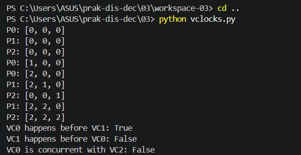

### 4.3 Membuat Modul Vector Clock

Class `VectorClock` dipisahkan ke [vector_clock.py](modul_3.2/vector_clock.py).
Class tersebut menyediakan method `increment`, `send_message`,
`receive_message`, `happens_before`, dan `is_concurrent`.

Contoh penggunaannya dibuat pada [main_vector.py](modul_3.2/main_vector.py).
Karena kedua file berada dalam direktori yang sama, modul dapat digunakan dengan
import berikut:

```python
from vector_clock import VectorClock
```

Program contoh dijalankan dengan:

```powershell
Set-Location .\03\modul_3.2
python .\main_vector.py
```

Dokumentasi tugas pembuatan modul terdapat pada gambar berikut.

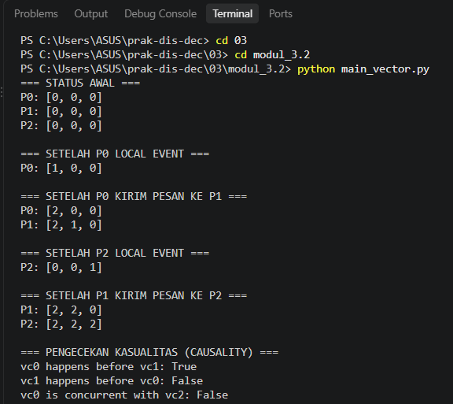

### 4.4 Menjalankan Program Multithreaded

Program multithreaded dijalankan dengan:

```powershell
python .\multithreads-example.py
```

Lima thread A sampai E dimulai hampir bersamaan. Masing-masing thread
menjalankan fungsi `task` dengan delay yang berbeda. Method `join()` membuat
program utama menunggu seluruh thread selesai.

Program dijalankan lebih dari satu kali dan hasilnya didokumentasikan untuk
menunjukkan bahwa urutan output dapat berbeda.

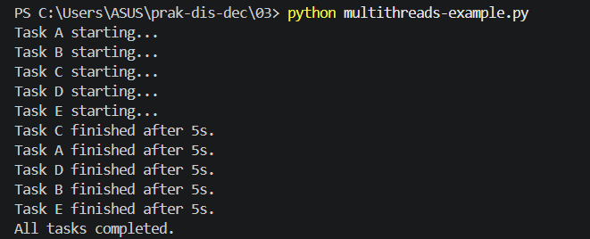

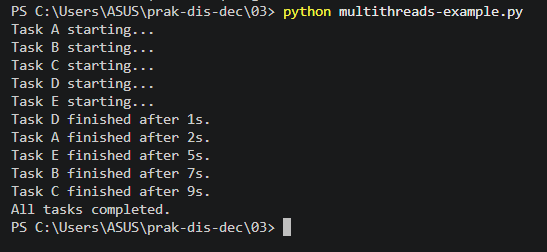

### 4.5 Mengamati Data Race

Program tanpa lock dijalankan menggunakan:

```powershell
python .\race-conditions-01.py
```

Program dengan lock dijalankan menggunakan:

```powershell
python .\race-conditions-02.py
```

Kedua thread mencoba menarik Rp80 dari saldo awal Rp100. Bagian pemeriksaan
saldo dan pengurangan saldo dibandingkan pada kedua program.

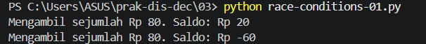

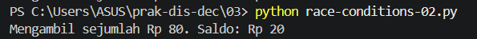

Visualisasi interleaving data race dibuat untuk menunjukkan dua thread yang
membaca saldo yang sama sebelum melakukan pengurangan.

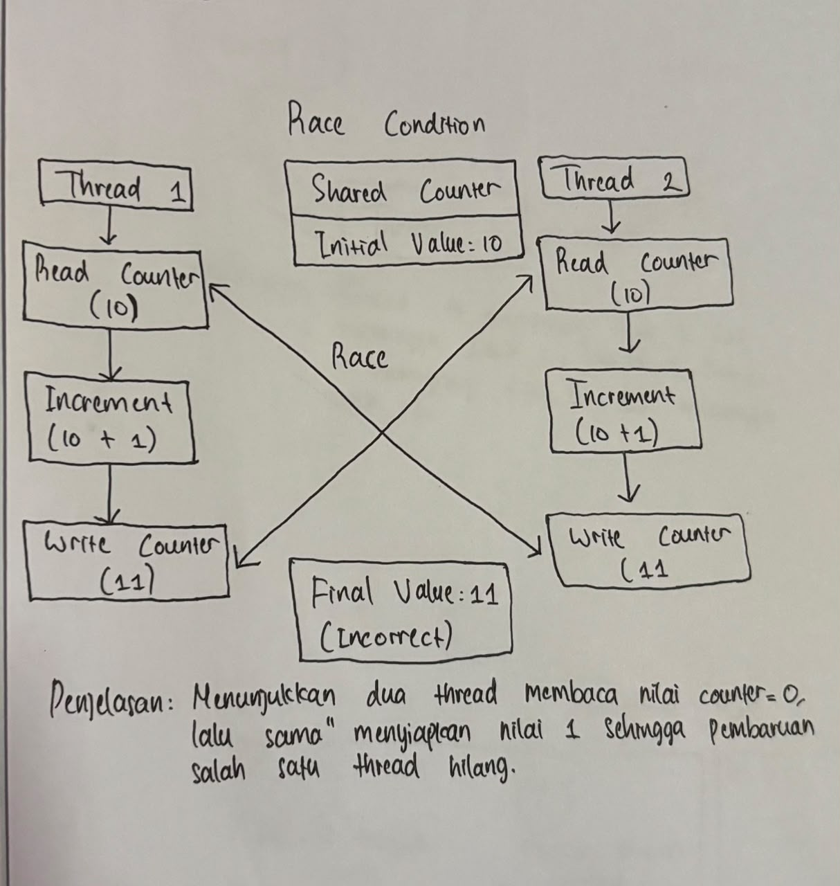

### 4.6 Mengamati Deadlock

Contoh deadlock dijalankan dengan:

```powershell
python .\deadlock-01.py
```

Pada program ini Thread 1 mengunci A kemudian menunggu B. Thread 2 mengunci B
kemudian menunggu A. Kedua thread menahan lock yang dimiliki sehingga membentuk
circular wait.

Program pencegah deadlock dijalankan dengan:

```powershell
python .\deadlock-02.py
```

Program kedua melepaskan lock pertama sebelum mengambil lock berikutnya dan
menggunakan timeout pada `acquire`. Dengan demikian, thread tidak menahan satu
lock sambil menunggu lock lain.

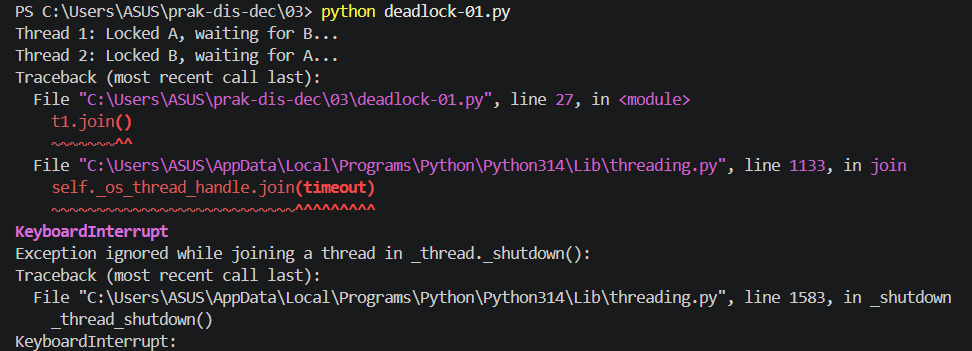

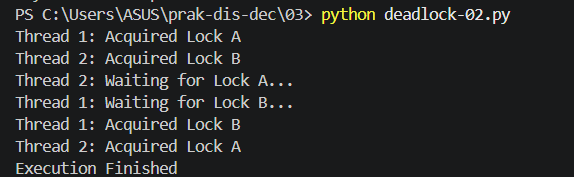

Visualisasi hubungan tunggu antar-thread didokumentasikan pada gambar berikut.

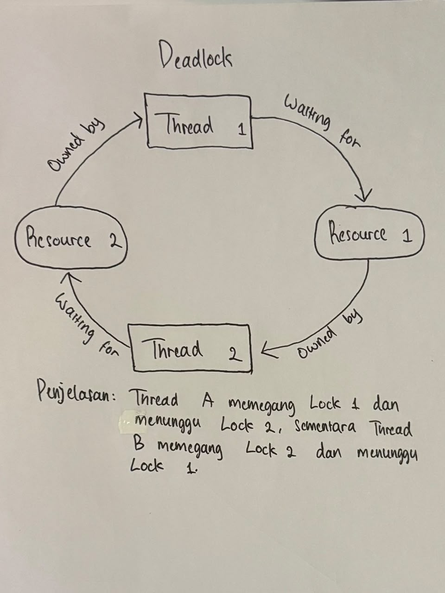

### 4.7 Menjalankan Simulasi Raft

Simulasi awal dijalankan dengan:

```powershell
python .\raft.py
```

Program membuat tiga node dan menjalankan 20 langkah simulasi. Pada setiap
langkah, program mencetak state, term, dan panjang log setiap node.

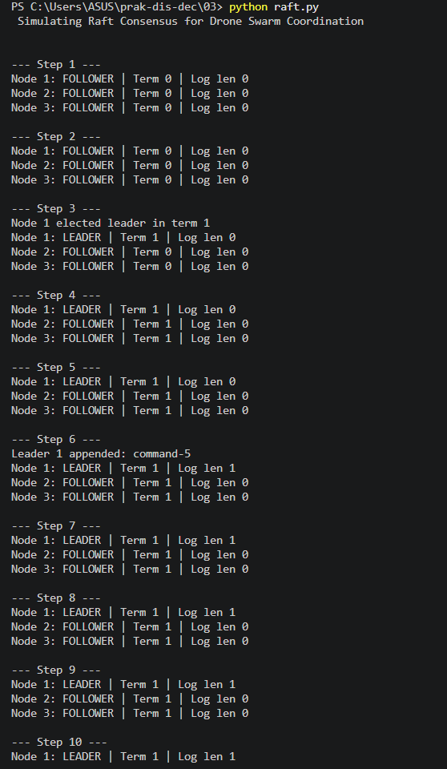

### 4.8 Membuat Modul Raft

Class `RaftNode` dipisahkan ke [raft_node.py](modul_3.4/raft_node.py).
Simulasi penggunaannya dibuat pada [main_raft.py](modul_3.4/main_raft.py).
Modul tersebut diimpor dengan:

```python
from raft_node import RaftNode, State
```

Contoh modul dijalankan menggunakan:

```powershell
Set-Location .\03\modul_3.4
python .\main_raft.py
```

Dokumentasi pembuatan modul Raft ditampilkan pada gambar berikut.

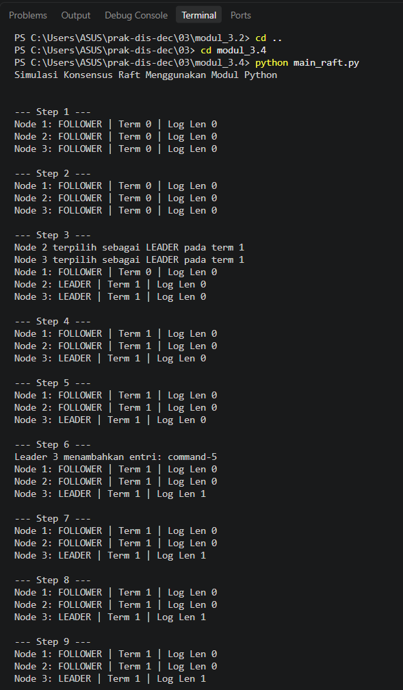

Visualisasi pemilihan leader dibuat berdasarkan perubahan state follower,
candidate, dan leader.

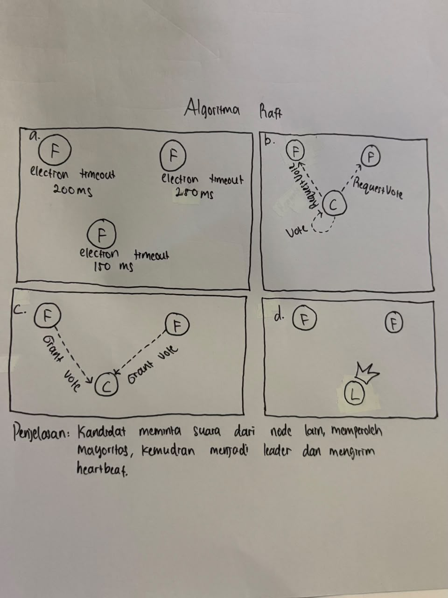

## 5. Hasil Praktikum

### 5.1 Hasil Sinkronisasi Waktu

NetTime berhasil digunakan untuk melakukan sinkronisasi waktu Windows dengan
server NTP. Proses yang terjadi adalah pemilihan server, pengiriman permintaan,
penerimaan waktu server, perhitungan offset, dan penyesuaian waktu lokal.

### 5.2 Hasil Vector Clock

Hasil perhitungan vector clock berdasarkan source code adalah:

| Tahap | P0 | P1 | P2 |
| --- | --- | --- | --- |
| Kondisi awal | `[0, 0, 0]` | `[0, 0, 0]` | `[0, 0, 0]` |
| P0 melakukan event lokal | `[1, 0, 0]` | `[0, 0, 0]` | `[0, 0, 0]` |
| P0 mengirim ke P1 | `[2, 0, 0]` | `[2, 1, 0]` | `[0, 0, 0]` |
| P2 melakukan event lokal | `[2, 0, 0]` | `[2, 1, 0]` | `[0, 0, 1]` |
| P1 mengirim ke P2 | `[2, 0, 0]` | `[2, 2, 0]` | `[2, 2, 2]` |

Output pengecekan kausalitas:

```text
vc0 happens before vc1: True
vc1 happens before vc0: False
vc0 is concurrent with vc2: False
```

Hasil tersebut sama dengan perhitungan manual. P0 terjadi sebelum P1 karena
vector P0 `[2, 0, 0]` tidak lebih besar pada setiap komponen daripada vector P1
`[2, 2, 0]`, serta terdapat komponen yang lebih kecil. P1 tidak terjadi sebelum
P0. P0 juga tidak concurrent dengan P2 karena event P0 menjadi bagian dari
rantai kausal yang berakhir pada P2.

### 5.3 Hasil Multithreading

Thread dimulai hampir bersamaan, tetapi waktu selesai dipengaruhi oleh delay
dan scheduler. Task D dengan delay satu detik cenderung selesai paling awal,
sedangkan task C dengan delay sembilan detik cenderung selesai paling akhir.
Pesan `starting` juga dapat memiliki urutan berbeda karena thread tidak
dijalankan secara sekuensial.

`join()` tidak mengatur urutan thread. `join()` hanya memastikan thread utama
menunggu sampai semua thread selesai sebelum menampilkan pesan akhir.

### 5.4 Hasil Data Race

Pada [race-conditions-01.py](race-conditions-01.py), kedua thread dapat
membaca saldo Rp100 sebelum salah satunya menyelesaikan operasi pengurangan.
Keduanya kemudian lolos dari pemeriksaan saldo dan saldo dapat berubah menjadi
Rp-60. Nilai tersebut tidak sesuai dengan aturan transaksi karena operasi
pemeriksaan dan pengurangan tidak dilindungi.

Urutan interleaving yang mungkin terjadi:

1. Thread 1 membaca saldo Rp100.
2. Thread 2 membaca saldo Rp100.
3. Thread 1 mengurangi Rp80 sehingga saldo menjadi Rp20.
4. Thread 2 juga mengurangi Rp80 berdasarkan pembacaan sebelumnya.
5. Saldo menjadi Rp-60.

Pada [race-conditions-02.py](race-conditions-02.py), pemeriksaan dan
pengurangan berada di dalam `with counter_lock`. Hanya satu thread yang dapat
memasuki critical section. Setelah thread pertama menghasilkan saldo Rp20,
thread kedua memeriksa kembali saldo dan tidak dapat melakukan penarikan.

### 5.5 Hasil Deadlock

Pada [deadlock-01.py](deadlock-01.py), Thread 1 memperoleh Lock A dan Thread 2
memperoleh Lock B. Thread 1 kemudian menunggu Lock B, sementara Thread 2
menunggu Lock A. Karena kedua thread masih memegang lock pertamanya, tidak ada
thread yang dapat melanjutkan. Inilah circular wait yang menyebabkan deadlock.
Pemanggilan `join()` membuat program utama ikut menunggu thread yang tidak
kunjung selesai.

Pada [deadlock-02.py](deadlock-02.py), setiap thread melepaskan lock pertama
sebelum mencoba memperoleh lock kedua. Selain itu, `acquire(timeout=5)`
membatasi waktu tunggu. Tidak ada thread yang menahan Lock A sambil menunggu
Lock B atau sebaliknya, sehingga circular wait tidak terbentuk dan program
menampilkan `Execution Finished`.

### 5.6 Hasil Simulasi Raft

Pada awal simulasi, semua node berada pada state `FOLLOWER` dan term 0. Setelah
election timeout tercapai, node menjadi `CANDIDATE`, menaikkan term, dan
memilih dirinya sendiri. Source code menyederhanakan pemungutan suara dengan
menganggap node lain memberikan suara. Karena setiap candidate dapat langsung
dianggap memperoleh suara dari semua node, lebih dari satu node bahkan dapat
sempat tercetak sebagai `LEADER` pada term yang sama. Setelah heartbeat
diproses, salah satu leader dapat mengubah node lain kembali menjadi follower.

Leader kemudian mengirim heartbeat kepada node lain. Pada beberapa langkah,
leader menambahkan command seperti `command-5`, `command-10`, dan `command-15`
ke log. Nomor node yang terpilih dan waktu pemilihannya dapat berbeda karena
election timeout dibuat secara acak.

Implementasi modul Raft merupakan simulasi sederhana. Replikasi log ke follower,
RPC nyata, pencegahan dua leader pada term yang sama, dan validasi log belum
diimplementasikan seperti pada Raft lengkap. Karena itu, output pemilihan leader
harus dipahami sebagai demonstrasi perubahan state, bukan jaminan konsensus
Raft yang lengkap.

## 6. Analisis

Sinkronisasi waktu menggunakan NTP menyamakan waktu fisik, sedangkan vector
clock tidak menyamakan jam. Vector clock menyimpan hubungan kausalitas sehingga
event dapat diurutkan berdasarkan pesan dan event lokal.

Program multithreaded memperlihatkan bahwa urutan eksekusi tidak dapat
diprediksi hanya dari urutan penulisan source code. Race condition terjadi
karena pemeriksaan dan perubahan saldo dapat disela oleh thread lain. Lock
membuat bagian tersebut menjadi critical section sehingga hanya satu thread
yang mengaksesnya pada satu waktu.

Deadlock berbeda dari race condition. Race condition menghasilkan data yang
tidak konsisten, sedangkan deadlock membuat thread tidak dapat melanjutkan.
Urutan pengambilan resource yang konsisten, pelepasan lock sebelum mengambil
lock berikutnya, dan timeout dapat digunakan untuk menghindari deadlock.

Simulasi Raft memperlihatkan konsep konsensus melalui timeout, term, state, dan
suara mayoritas. Walaupun belum menangani seluruh mekanisme Raft, simulasi
tersebut cukup untuk menunjukkan cara node memilih koordinator dan
mempertahankan status leader melalui heartbeat.

## 7. Kendala dan Solusi

| Kendala yang Ditemukan | Solusi atau Pemahaman yang Diperoleh |
| --- | --- |
| Output thread berubah pada setiap eksekusi. | Perbedaan dicatat sebagai akibat scheduler dan eksekusi konkuren. |
| Data race tidak selalu terlihat tanpa delay. | `time.sleep(0.01)` memperbesar peluang terjadinya interleaving. |
| Program deadlock berhenti dan tidak menampilkan output akhir. | Circular wait diamati melalui visualisasi, kemudian program dihentikan setelah kondisi deadlock terbukti. |
| Hasil pemilihan leader Raft dapat berubah. | Timeout acak dipahami sebagai penyebab node dan waktu pemilihan yang berbeda. |
| Vector clock sulit diverifikasi hanya dari output. | Setiap perubahan vector ditulis dalam tabel dan dibandingkan dengan algoritma manual. |
| Modul harus dapat digunakan dari program lain. | Class dipisahkan ke `vector_clock.py` dan `raft_node.py`, lalu dipanggil melalui program utama masing-masing. |
| Waktu komputer perlu disamakan dengan server. | NetTime dikonfigurasi menggunakan server NTP sebelum sinkronisasi dilakukan. |

## 8. Kesimpulan

Praktikum modul 3 menunjukkan bahwa sinkronisasi merupakan bagian penting dalam
sistem terdistribusi. NetTime melakukan sinkronisasi waktu komputer melalui NTP,
sedangkan vector clock digunakan untuk menentukan hubungan kausalitas tanpa
bergantung pada jam fisik.

Multithreading menghasilkan urutan output yang tidak selalu sama. Data race
terjadi ketika saldo bersama diakses tanpa lock dan dapat dicegah menggunakan
`threading.Lock`. Deadlock terjadi ketika dua thread saling menunggu lock yang
dipegang thread lain, sedangkan pelepasan lock sebelum meminta lock berikutnya
dan timeout dapat mencegah kondisi tersebut.

Simulasi Raft memperlihatkan bahwa follower dapat menjadi candidate dan
kemudian leader setelah memperoleh suara mayoritas. Pembuatan modul vector
clock dan modul Raft juga menunjukkan cara memisahkan class agar dapat
digunakan kembali oleh program lain.

## 9. Referensi

1. [Chrony Project](https://chrony-project.org/)
2. [NetTime](https://www.timesynctool.com/)
3. [Python `threading` documentation](https://docs.python.org/3/library/threading.html)
4. [Python `time` documentation](https://docs.python.org/3/library/time.html)
5. [Raft Consensus Algorithm](https://raft.github.io/)
6. [Simulate Distributed Consensus with the Raft Protocol](https://www.c-sharpcorner.com/article/simulate-distributed-consensus-with-the-raft-protocol-simplified-using-python/)