# Laporan Praktikum Sistem Terdistribusi dan Terdesentralisasi

## Pertemuan 04: Konsistensi dan Replikasi pada Sistem Terdistribusi

### Identitas

- Nama: **Diana Amelia**
- NIM: **255410042**
- Kelas: **Informatika-1**

## 1. Tujuan

1. Memahami konsep konsistensi dan replikasi pada sistem terdistribusi.
2. Mengonfigurasi streaming replication PostgreSQL 18 menggunakan Docker Compose.
3. Membuktikan bahwa perubahan pada primary direplikasi ke standby secara otomatis.
4. Memahami proses failover dengan mempromosikan replica menjadi primary.
5. Mengonfigurasi cluster Apache Ignite 3.1.0 dengan tiga node.
6. Mengeksekusi file SQL dan membuktikan bahwa data tersedia pada node-node
   dalam cluster master-master.
7. Membandingkan karakteristik replikasi primary-standby PostgreSQL dengan
   replikasi multi-primary Apache Ignite.

## 2. Dasar Teori

### 2.1 Konsistensi dan Replikasi

Replikasi adalah proses menyimpan salinan data pada lebih dari satu node.
Replikasi meningkatkan ketersediaan dan dapat membantu pembagian beban baca.
Konsistensi berarti salinan-salinan tersebut tetap menunjukkan keadaan data
yang sesuai setelah operasi dilakukan.

Pada sistem terdistribusi, replikasi perlu memperhatikan urutan perubahan,
keterlambatan jaringan, kegagalan node, dan konflik penulisan. Karena itu,
model replikasi dan batas konsistensi harus dipilih sesuai kebutuhan aplikasi.

### 2.2 Streaming Replication PostgreSQL

Streaming replication PostgreSQL menggunakan model **primary-standby**.
Primary menerima operasi baca dan tulis, sedangkan standby menerima perubahan
melalui WAL (Write-Ahead Log) dan umumnya hanya menyediakan akses baca.

Pada praktikum ini, `wal_level=replica`, `max_wal_senders`, dan
`max_replication_slots` diaktifkan pada primary. `pg_basebackup` membuat
salinan awal data primary ke replica, sedangkan opsi `-R` menulis konfigurasi
agar replica melanjutkan proses recovery dan terhubung ke primary.

### 2.3 High Availability dan Failover

High Availability (HA) bertujuan mengurangi waktu layanan tidak tersedia saat
sebuah node mengalami kegagalan. Jika primary mati, standby yang telah
memiliki data terbaru dapat dipromosikan menggunakan `pg_promote()`. Setelah
promosi, nilai `pg_is_in_recovery()` berubah dari `true` menjadi `false` dan
node tersebut dapat menerima operasi tulis.

Promosi replica pada praktikum ini merupakan **failover manual**. Dalam sistem
produksi, pemilihan primary baru biasanya dibantu oleh orkestrator atau
manajer HA.

### 2.4 Replikasi Master-Master Apache Ignite

Apache Ignite adalah platform terdistribusi yang menyediakan penyimpanan data
dan komputasi dalam cluster. Dalam konfigurasi tiga node pada praktikum ini,
setiap node dapat menjadi endpoint untuk operasi SQL. Perubahan metadata dan
data dikelola oleh cluster sehingga data dapat diakses melalui node yang
berbeda.

Model ini disebut master-master karena tidak hanya satu node yang ditetapkan
sebagai primary untuk menerima seluruh operasi tulis. Ketersediaan data
diuji dengan menjalankan query yang sama pada node 1, node 2, dan node 3.

## 3. Alat dan Bahan

- Komputer atau laptop dengan Windows.
- Docker Desktop dengan Docker Engine aktif.
- Docker Compose.
- Windows PowerShell.
- Repository GitHub: [prak-dis-dec](https://github.com/dianaamelia24/prak-dis-dec).
- Source code praktikum pada folder [04](../04/).
- Image `postgres:18.3-alpine3.23`.
- Image `apacheignite/ignite:3.1.0`.

File utama yang digunakan adalah:

- [00_init.sql](src/00_init.sql)
- [docker-compose.yaml PostgreSQL](src/docker-compose.yaml)
- [env.sh PostgreSQL](src/env.sh)
- [docker-compose.yaml Apache Ignite](src_2/docker-compose.yaml)
- [env.sh Apache Ignite](src_2/env.sh)
- File SQL pada folder [sql](src_2/sql/)

## 4. Langkah Pengerjaan

### 4.1 Memeriksa Docker dan Docker Compose

Prasyarat diperiksa melalui PowerShell. Hasil pemeriksaan menunjukkan Docker
Engine dan Docker Compose telah tersedia:

```powershell
docker --version
docker compose version
docker info
```

Versi yang terlihat pada hasil praktikum adalah Docker `29.9.2` dan Docker
Compose `v5.6.1`. Perintah `docker info` juga berhasil menampilkan informasi
server, sehingga daemon Docker dapat digunakan.

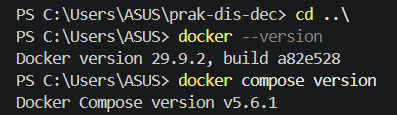

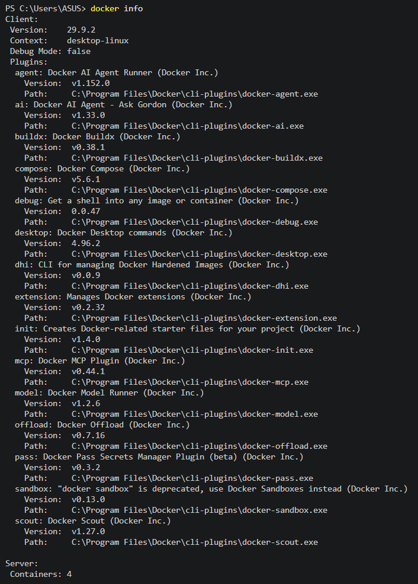

### 4.2 Menyiapkan Struktur Streaming Replication

Konfigurasi PostgreSQL disimpan dalam folder [src](src/). File
[00_init.sql](src/00_init.sql) dijalankan otomatis ketika primary pertama kali
diinisialisasi. Isinya membuat user replikasi dan physical replication slot:

```sql
CREATE USER replicator WITH REPLICATION
  ENCRYPTED PASSWORD 'replicator_password';
SELECT pg_create_physical_replication_slot('replication_slot');
```

File [docker-compose.yaml](src/docker-compose.yaml) mendefinisikan dua
service:

- `postgres_primary` pada port host `5432`;
- `postgres_replica` pada port host `5433`.

Primary menggunakan PostgreSQL 18.3 Alpine dengan `wal_level=replica`,
`hot_standby=on`, `max_wal_senders=10`, dan
`max_replication_slots=10`. Replica menggunakan
`PGDATA=/var/lib/postgresql/18/docker`, sesuai lokasi data PostgreSQL 18 pada
image yang digunakan. Perintah `pg_basebackup -R` mengambil salinan awal dari
primary melalui slot `replication_slot`.

Alias pada [env.sh](src/env.sh) digunakan sebagai shortcut untuk menjalankan
Compose, melihat container, dan membaca log. Pada Windows, perintah
`docker compose` dijalankan langsung dari PowerShell karena alias pada file
tersebut menggunakan sintaks `sudo` untuk Linux.

### 4.3 Menjalankan PostgreSQL Primary dan Replica

Container dijalankan dari folder `04/src` dengan perintah:

```powershell
Set-Location .\04\src
docker compose up -d
docker compose ps
```

Output menunjukkan network dibuat dan dua container berhasil dijalankan.
Pemeriksaan status memperlihatkan `postgres_primary` dan `postgres_replica`
berstatus **healthy**. Dengan demikian, primary dan standby sudah aktif dalam
satu network Compose.

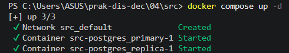

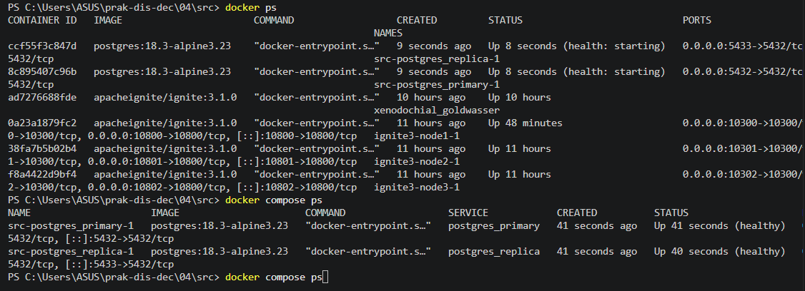

Log primary memperlihatkan PostgreSQL 18.3 telah siap menerima koneksi. Log
inisialisasi juga menunjukkan [00_init.sql](src/00_init.sql) berhasil
dijalankan, ditandai dengan output `CREATE ROLE` dan
`pg_create_physical_replication_slot`.

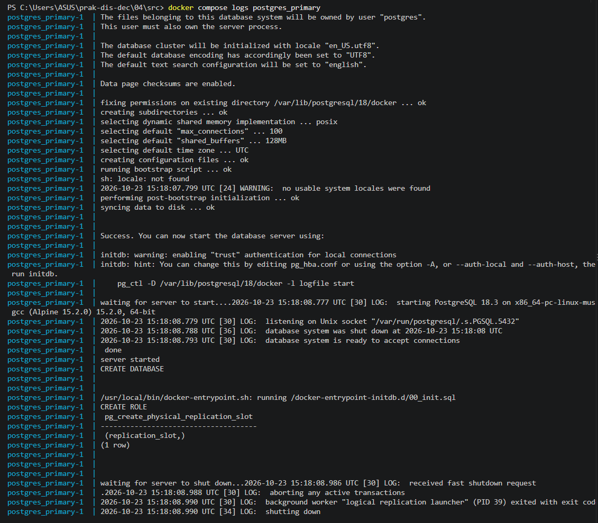

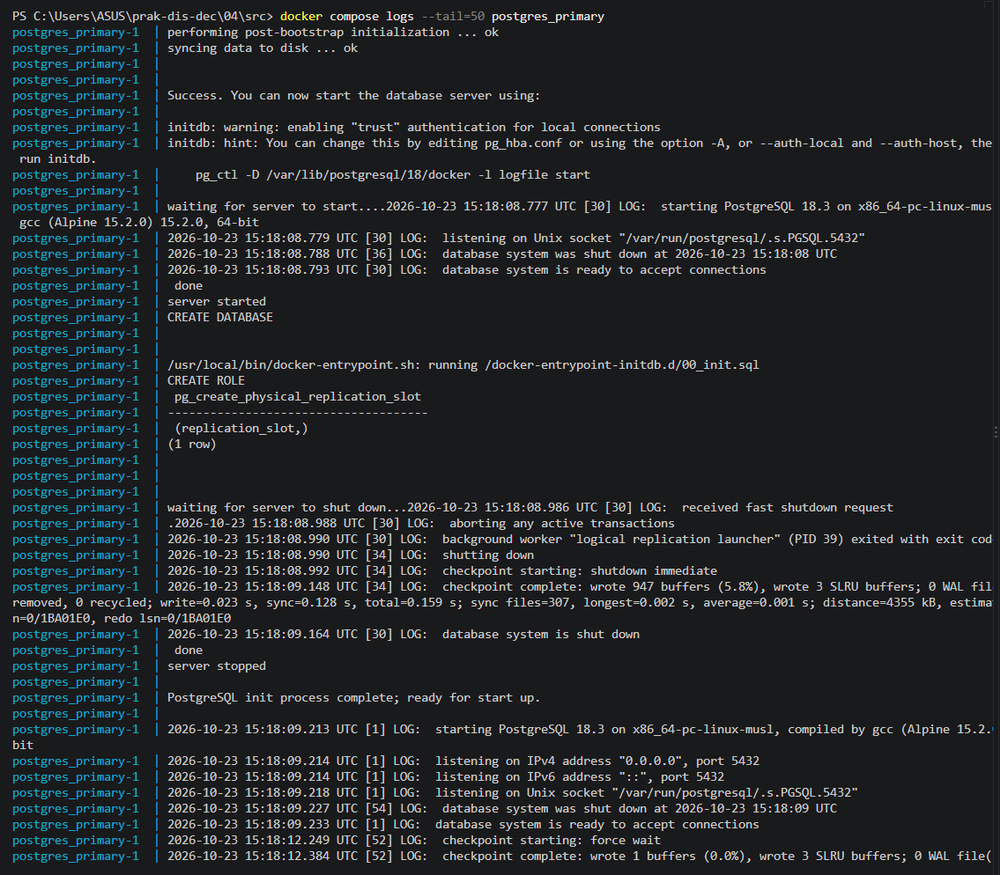

### 4.4 Memeriksa Status Replica

Koneksi ke database pada replica dilakukan dengan:

```powershell
docker compose exec postgres_replica psql -U zuser -d zdb
```

Status recovery diperiksa menggunakan:

```sql
SELECT pg_is_in_recovery();
```

Hasil `t` (`true`) membuktikan bahwa server tersebut masih berada pada mode
recovery dan berperan sebagai standby. Hal ini sesuai dengan model
primary-standby PostgreSQL.

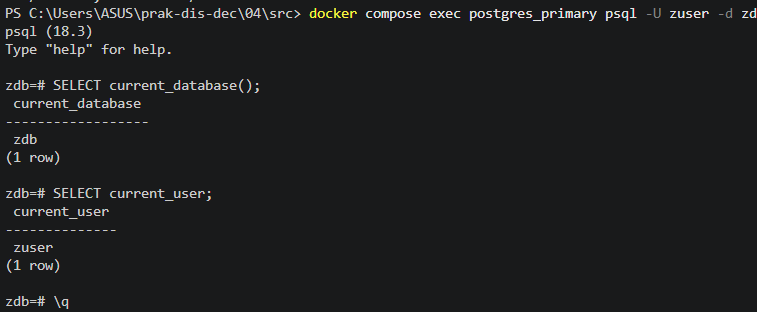

Pada percobaan pemeriksaan WAL receiver, query awal menggunakan kolom
`username` yang tidak tersedia pada versi katalog yang digunakan sehingga
menghasilkan error `column "username" does not exist`. Kesalahan tersebut
berasal dari nama kolom query diagnostik, bukan dari kegagalan replikasi.
Status recovery dan pengujian data pada langkah berikutnya tetap berhasil.

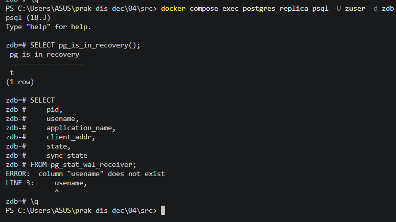

### 4.5 Menguji Replikasi Data PostgreSQL

Pada primary dibuat tabel pengujian dan satu baris data:

```sql
CREATE TABLE replication_test (
  id INTEGER PRIMARY KEY,
  message VARCHAR(100),
  created_at TIMESTAMP DEFAULT CURRENT_TIMESTAMP
);

INSERT INTO replication_test (id, message)
VALUES (1, 'Data dibuat pada primary');
```

Data pada primary diperiksa menggunakan:

```sql
SELECT * FROM replication_test;
```

Kemudian query yang sama dijalankan pada replica. Baris dengan pesan
`Data dibuat pada primary` muncul pada replica tanpa proses insert ulang.
Hasil ini membuktikan bahwa perubahan pada primary telah dikirim melalui WAL
dan diterapkan pada standby.

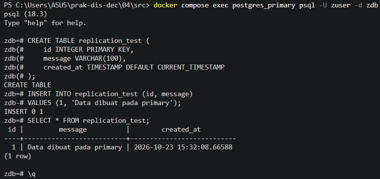

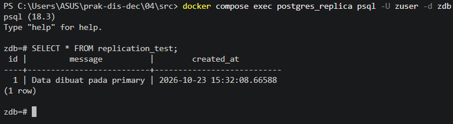

### 4.6 Menguji Failover dan Promosi Replica

Primary dihentikan untuk mensimulasikan kegagalan node:

```powershell
docker compose stop postgres_primary
docker compose ps
```

Pemeriksaan status menunjukkan hanya `postgres_replica` yang masih berjalan.

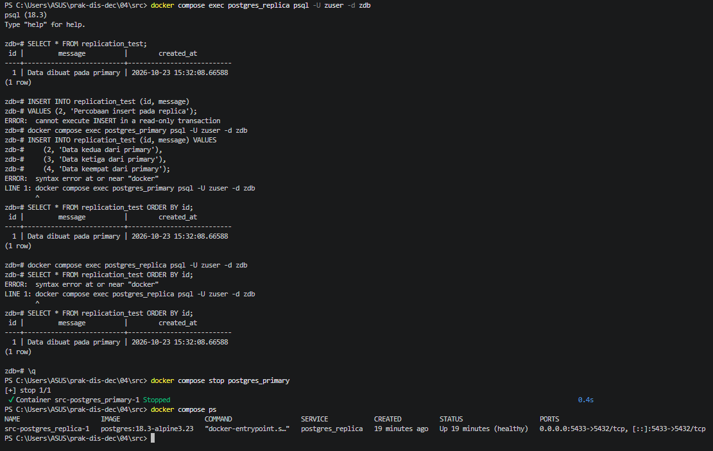

Pada replica, status awal diverifikasi lalu replica dipromosikan:

```sql
SELECT pg_is_in_recovery();
SELECT pg_promote();
SELECT pg_is_in_recovery();
```

Sebelum promosi hasilnya `t`, sedangkan sesudah `pg_promote()` hasilnya `f`.
Perubahan ini membuktikan bahwa replica telah berubah menjadi server
read-write.

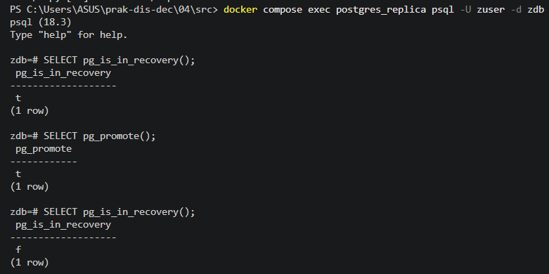

Setelah promosi, data baru berhasil ditulis:

```sql
INSERT INTO replication_test (id, message)
VALUES (5, 'Data setelah replica dipromosikan');

SELECT * FROM replication_test ORDER BY id;
```

Hasil query menampilkan data awal dan data baru setelah promosi. Ini
membuktikan bahwa failover manual berhasil mengubah standby menjadi primary
baru.

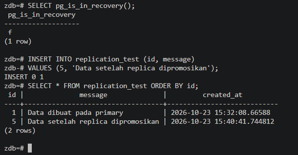

### 4.7 Menyiapkan Cluster Apache Ignite

Konfigurasi Apache Ignite disimpan pada folder [src_2](src_2/). File
[docker-compose.yaml](src_2/docker-compose.yaml) mendefinisikan tiga service:
`node1`, `node2`, dan `node3`, menggunakan image
`apacheignite/ignite:3.1.0`.

Port REST API yang dipetakan adalah:

- node 1: `10300`;
- node 2: `10301`;
- node 3: `10302`.

Port aplikasi yang dipetakan adalah `10800`, `10801`, dan `10802`. Konfigurasi
network menggunakan port `3344` dan daftar node
`node1:3344`, `node2:3344`, serta `node3:3344` sebagai node finder.

Cluster dijalankan dari folder `04/src_2`:

```powershell
Set-Location .\04\src_2
docker compose up -d
docker compose ps
```

Ketiga container berada pada status **Running** dan dapat diakses melalui
port REST masing-masing.

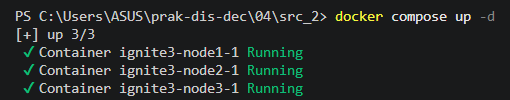

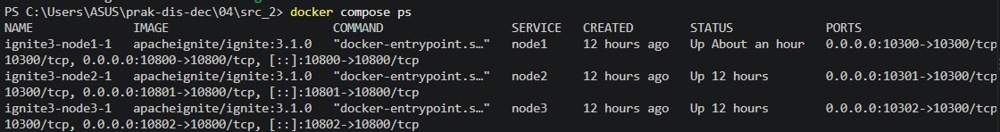

Log node menunjukkan aktivitas checkpoint, compaction, dan metrics exporter.
Aktivitas tersebut merupakan proses internal cluster dalam mengelola
penyimpanan dan metadata.

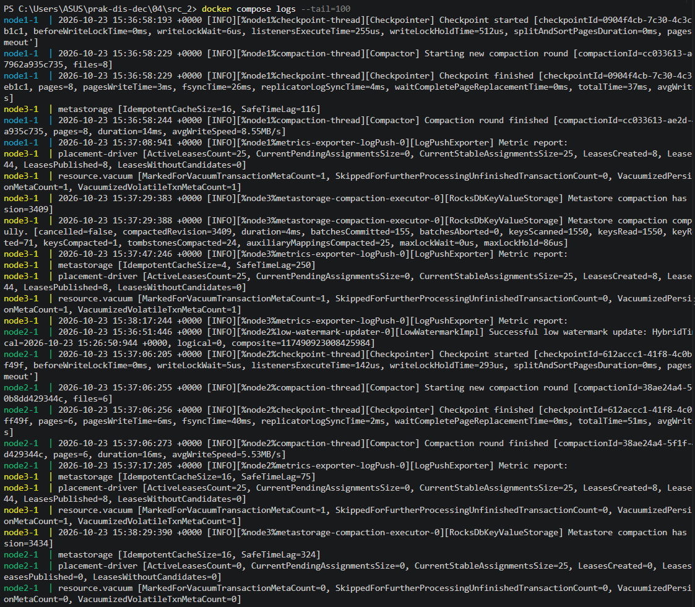

### 4.8 Menginisialisasi Cluster Apache Ignite

CLI Apache Ignite dijalankan menggunakan image yang sama dan network host:

```powershell
docker run --rm -it --network=host `
  -e LANG=C.UTF-8 -e LC_ALL=C.UTF-8 `
  apacheignite/ignite:3.1.0 cli
```

Setelah terhubung ke `http://localhost:10300`, cluster diinisialisasi dengan:

```text
cluster init --name=ignite3 --metastorage-group=node1,node2,node3
```

Output `Cluster was initialized successfully` menunjukkan inisialisasi
metastorage group berhasil.

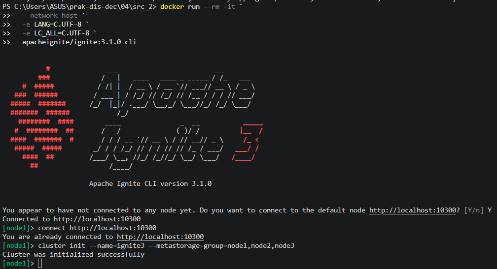

### 4.9 Mengeksekusi File SQL dan Memeriksa Tabel

File SQL pada [src_2/sql](src_2/sql/) dimount ke container CLI:

```powershell
docker run --rm -it --network=host `
  -e LANG=C.UTF-8 -e LC_ALL=C.UTF-8 `
  -v .\sql:/opt/ignite/sql `
  apacheignite/ignite:3.1.0 cli
```

Di dalam CLI, mode SQL digunakan untuk memeriksa tabel publik:

```text
sql
SELECT TABLE_NAME, ZONE_NAME
FROM system.tables
WHERE schema = 'PUBLIC'
ORDER BY TABLE_NAME;
```

Hasilnya memuat tabel seperti `ALBUM`, `ARTIST`, `CUSTOMER`, `INVOICE`,
`TRACK`, dan tabel lain dari dataset Chinook. Hasil lain dari
`system.tables` juga memperlihatkan tabel `MAHASISWA`, sehingga cluster dapat
menyimpan tabel yang dibuat selain dataset contoh.

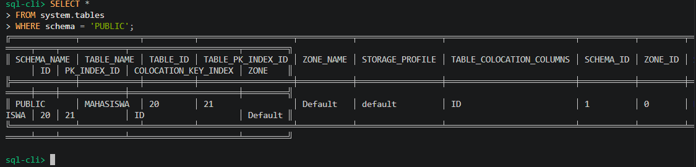

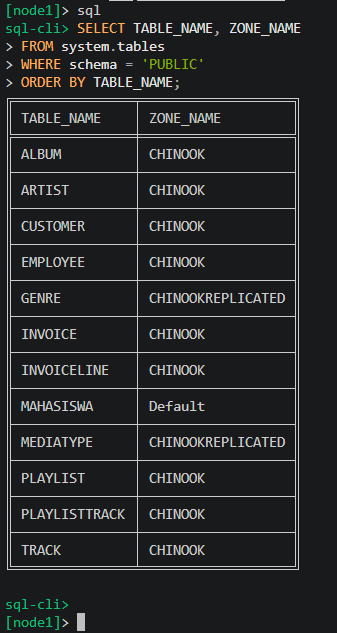

### 4.10 Membuktikan Data Tersedia pada Semua Node

Jumlah baris pada beberapa tabel diperiksa melalui node 1:

```sql
SELECT COUNT(*) AS artist_count FROM Artist;
SELECT COUNT(*) AS album_count FROM Album;
SELECT COUNT(*) AS track_count FROM Track;
SELECT COUNT(*) AS customer_count FROM Customer;
SELECT COUNT(*) AS invoice_count FROM Invoice;
```

Hasil pada node 1 adalah 275 artist, 347 album, 3503 track, 59 customer,
dan 412 invoice. Koneksi kemudian dialihkan ke node 2 dan node 3 dengan:

```text
connect http://localhost:10301
connect http://localhost:10302
```

Query yang sama menghasilkan jumlah yang identik pada kedua node tersebut.
Kesamaan hasil membuktikan bahwa data dapat dibaca melalui seluruh node
cluster, bukan hanya melalui node tempat SQL pertama kali dijalankan.

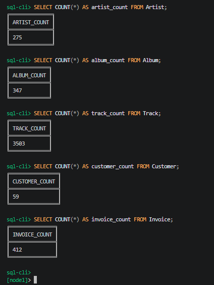

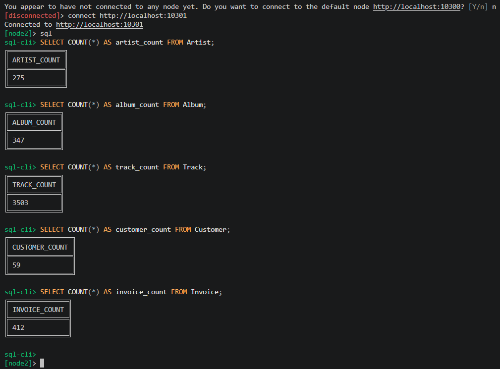

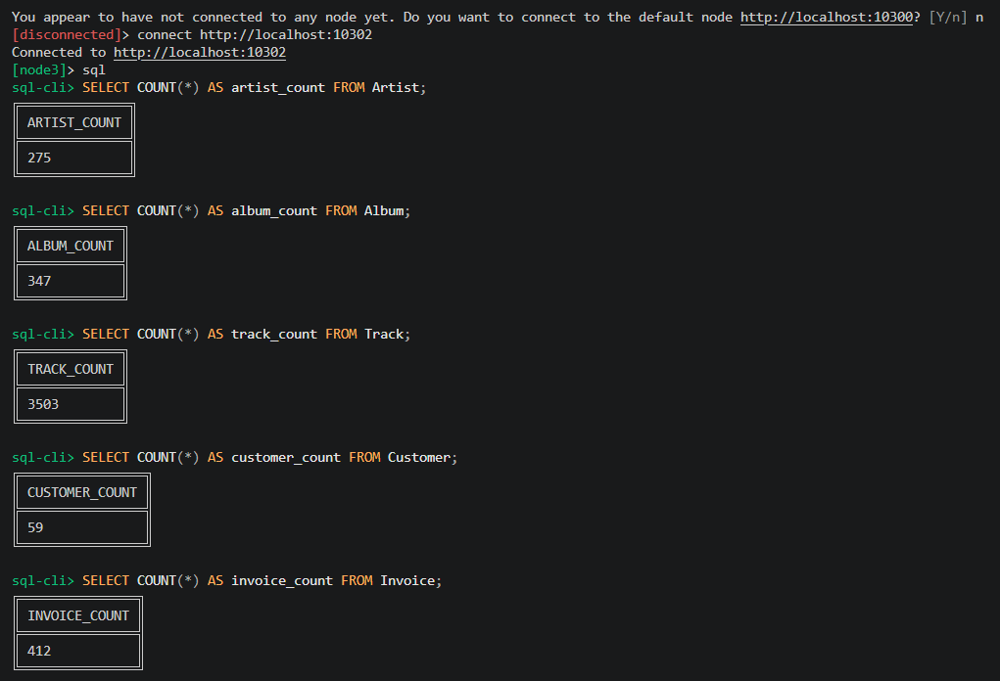

### 4.11 Menjalankan Query Analitik pada Tiga Node

Untuk menguji konsistensi hasil query pada seluruh cluster, ringkasan
penjualan bulanan dijalankan pada node 1, node 2, dan node 3:

```sql
SELECT
  CAST(EXTRACT(YEAR FROM i.InvoiceDate) AS VARCHAR) || '-' ||
  CASE
    WHEN EXTRACT(MONTH FROM i.InvoiceDate) < 10
      THEN '0' || CAST(EXTRACT(MONTH FROM i.InvoiceDate) AS VARCHAR)
    ELSE CAST(EXTRACT(MONTH FROM i.InvoiceDate) AS VARCHAR)
  END AS YearMonth,
  COUNT(DISTINCT i.InvoiceId) AS InvoiceCount,
  COUNT(DISTINCT i.CustomerId) AS CustomerCount,
  SUM(i.Total) AS MonthlyRevenue,
  AVG(i.Total) AS AverageOrderValue
FROM Invoice i
GROUP BY
  EXTRACT(YEAR FROM i.InvoiceDate),
  EXTRACT(MONTH FROM i.InvoiceDate)
ORDER BY YearMonth DESC;
```

Output node 1, node 2, dan node 3 menampilkan periode, jumlah invoice, jumlah
customer, pendapatan bulanan, dan nilai rata-rata order yang sama. Pengujian
ini memperkuat bahwa replikasi dan konsistensi data berlaku saat query
agregasi dijalankan dari setiap endpoint cluster.

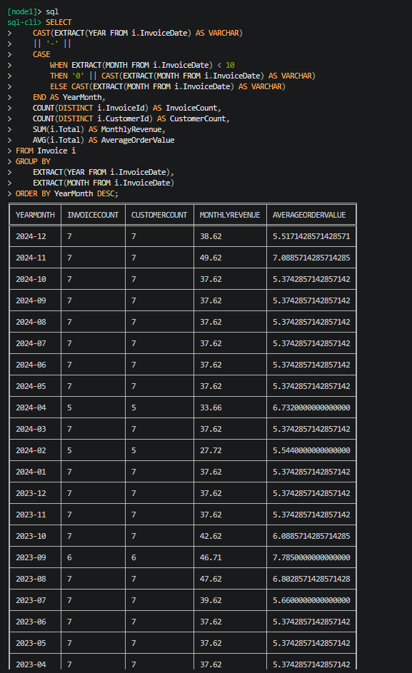

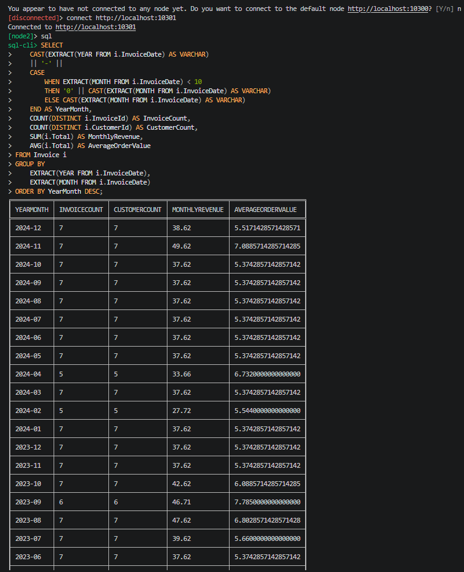

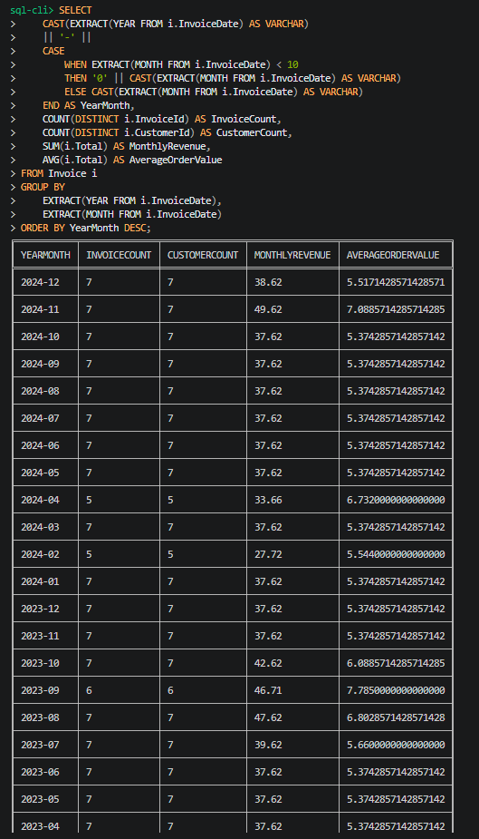

### 4.12 Menghentikan Service

Setelah seluruh pengujian selesai, service dapat dihentikan dengan:

```powershell
docker compose down
```

Perintah tersebut menghentikan dan menghapus container serta network yang
dibuat oleh Compose. Pada PostgreSQL, perintah dijalankan dari `04/src`,
sedangkan pada Apache Ignite dijalankan dari `04/src_2`.

## 5. Hasil dan Analisis

### 5.1 Hasil PostgreSQL

Streaming replication berhasil karena:

1. primary dan replica berstatus **healthy**;
2. `pg_is_in_recovery()` pada replica menghasilkan `true`;
3. data yang dibuat pada primary muncul pada replica;
4. setelah primary dihentikan, replica dapat dipromosikan;
5. setelah promosi, `pg_is_in_recovery()` menghasilkan `false` dan insert
   baru berhasil dilakukan.

Model ini memberikan salinan data dan kemampuan failover, tetapi proses
penulisan normal tetap terpusat pada primary. Karena itu, aplikasi harus
mengetahui endpoint primary untuk operasi tulis dan endpoint replica untuk
akses baca atau menyediakan mekanisme pengalihan koneksi setelah failover.

### 5.2 Hasil Apache Ignite

Cluster Apache Ignite tiga node berhasil diinisialisasi. Query pada node 1,
node 2, dan node 3 menghasilkan jumlah data yang sama:

| Tabel | Jumlah baris |
|---|---:|
| Artist | 275 |
| Album | 347 |
| Track | 3503 |
| Customer | 59 |
| Invoice | 412 |

Hasil query analitik pada node 1, node 2, dan node 3 juga konsisten. Hal ini
menunjukkan bahwa cluster menyediakan akses data melalui seluruh node dan
tidak bergantung pada satu endpoint saja.

### 5.3 Perbandingan Model Replikasi

| Aspek | PostgreSQL streaming replication | Apache Ignite cluster |
|---|---|---|
| Model | Primary-standby | Multi-node/master-master |
| Operasi tulis normal | Terpusat pada primary | Dapat dilayani melalui node cluster |
| Status standby | `pg_is_in_recovery() = true` | Node merupakan anggota cluster |
| Failover | Replica dipromosikan secara manual | Ketersediaan dikelola oleh cluster |
| Pengujian | Data primary muncul pada replica | Query menghasilkan data sama pada 3 node |
| Kegunaan utama | Backup, read scaling, dan HA | Distribusi data dan akses cluster |

## 6. Kendala dan Penyelesaian

1. Petunjuk modul menggunakan `sudo` dan alias Bash, sedangkan praktikum
   dijalankan pada Windows PowerShell. Penyelesaiannya adalah menjalankan
   perintah Docker Compose secara langsung tanpa `sudo`.
2. Query diagnostik `pg_stat_wal_receiver` menggunakan kolom `username` yang
   tidak tersedia pada hasil praktikum. Pemeriksaan kemudian difokuskan pada
   `pg_is_in_recovery()` dan verifikasi data, yang berhasil membuktikan status
   replica dan replikasi.
3. PostgreSQL menggunakan lokasi data `/var/lib/postgresql/18/docker`.
   Lokasi ini harus sama dengan nilai `PGDATA` dan target `pg_basebackup` agar
   proses inisialisasi replica berhasil.

## 7. Kesimpulan

Praktikum Modul 4 berhasil mencapai tujuan pembelajaran. PostgreSQL 18
berhasil dikonfigurasi dengan streaming replication menggunakan satu primary
dan satu replica. Replikasi diverifikasi melalui status recovery serta
munculnya data yang dibuat pada primary di replica. Simulasi kegagalan juga
berhasil ditangani dengan mempromosikan replica menjadi primary baru dan
melakukan operasi tulis.

Apache Ignite 3.1.0 juga berhasil dijalankan sebagai cluster tiga node.
Cluster dapat diinisialisasi, file SQL dapat dieksekusi, dan data yang sama
dapat dibaca dari node 1, node 2, serta node 3. Dengan demikian, praktikum
menunjukkan perbedaan antara streaming replication primary-standby dan model
cluster multi-node yang menyediakan akses data melalui beberapa node.

## 8. Daftar Pustaka

1. PostgreSQL Global Development Group. *PostgreSQL Documentation*.
   https://www.postgresql.org/docs/
2. Docker Inc. *Docker Documentation*. https://docs.docker.com/
3. Apache Ignite. *Apache Ignite 3 Documentation*.
   https://ignite.apache.org/docs/ignite3/latest/index
4. Eremeykin. *How to Setup Single-Primary PostgreSQL Replication with
   Docker Compose*. https://medium.com/@eremeykin/how-to-setup-single-primary-postgresql-replication-with-docker-compose-98c48f233bbf