
# Laporan Praktikum Sistem Terdistribusi dan Terdesentralisasi

## Pertemuan 05: Fault Tolerance

### Identitas

- Nama: **Diana Amelia**
- NIM: **255410042**
- Kelas: **Informatika-1**

## 1. Tujuan

1. Memahami konsep fault tolerance pada sistem terdistribusi.
2. Menjalankan aplikasi ASGI Python menggunakan framework BlackSheep.
3. Membuat image aplikasi dan proxy menggunakan Docker.
4. Melakukan scaling aplikasi menjadi dua instance dengan Docker Compose.
5. Mengonfigurasi Nginx sebagai proxy load balancer.
6. Menguji failure detection menggunakan pemeriksaan koneksi dan heartbeat sederhana.
7. Menerapkan retry dan circuit breaker untuk menangani kegagalan koneksi layanan.
8. Menganalisis perbedaan perilaku sistem ketika layanan aktif dan tidak aktif.

## 2. Dasar Teori

### 2.1 Fault Tolerance

Fault tolerance adalah kemampuan sistem untuk tetap menyediakan layanan ketika
sebagian komponen mengalami kegagalan. Pada aplikasi terdistribusi, toleransi
terhadap kegagalan dapat dibangun dengan menjalankan beberapa instance aplikasi,
mendeteksi kondisi gagal, mencoba kembali koneksi, dan menghentikan sementara
permintaan ke layanan yang sedang bermasalah.

### 2.2 Load Balancing

Load balancing adalah proses membagi request dari client ke beberapa server
backend. Dalam praktikum ini, Nginx bertindak sebagai reverse proxy. Client hanya
mengakses Nginx melalui port 80, kemudian Nginx meneruskan request ke service
`bs_app` yang dijalankan dalam dua container. Dengan demikian, beban tidak hanya
ditangani oleh satu proses aplikasi.

### 2.3 Failure Detection

Failure detection digunakan untuk menentukan apakah komponen masih dapat
dihubungi. Pemeriksaan sederhana dapat dilakukan dengan membuka koneksi TCP ke
host dan port tertentu. Jika koneksi berhasil, server dianggap aktif; jika
koneksi ditolak atau gagal, server dianggap tidak aktif.

### 2.4 Retry

Retry adalah mekanisme mengulangi request yang gagal selama jumlah percobaan
belum mencapai batas. Jeda antarpercobaan digunakan agar layanan memiliki waktu
untuk pulih. Pada script `check-retry.py`, request dicoba paling banyak lima kali
dengan jeda yang meningkat hingga batas tertentu. Retry membantu menghadapi
gangguan sementara, tetapi tidak menyelesaikan kegagalan permanen.

### 2.5 Circuit Breaker

Circuit breaker adalah pola yang mencegah kegagalan berantai. Pada keadaan
`closed`, request diizinkan. Setelah jumlah kegagalan mencapai ambang batas,
sirkuit berpindah ke `open` dan request berikutnya ditolak sementara. Setelah
`reset_timeout`, sirkuit dapat masuk ke `half-open` untuk menguji layanan.
Request yang berhasil menutup kembali sirkuit, sedangkan kegagalan membuatnya
tetap terbuka.

## 3. Alat dan Bahan

- Komputer atau laptop.
- Windows PowerShell.
- Docker Desktop dan Docker Compose.
- Python.
- `uv` sebagai pengelola virtual environment dan package Python.
- Framework BlackSheep dan `blacksheep-cli`.
- Nginx.
- Repository GitHub: [prak-dis-dec](https://github.com/dianaamelia24/prak-dis-dec).
- Folder kerja praktikum: [`workspace-05`](workspace-05/).

## 4. Langkah Pengerjaan

### 4.1 Memeriksa Docker dan Python

Pemeriksaan awal dilakukan untuk memastikan Docker dan Python tersedia pada
komputer. Docker digunakan untuk membangun image dan menjalankan container,
sedangkan Python digunakan untuk menjalankan aplikasi BlackSheep dan script
pengujian.

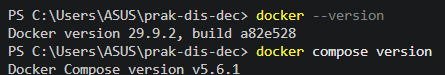

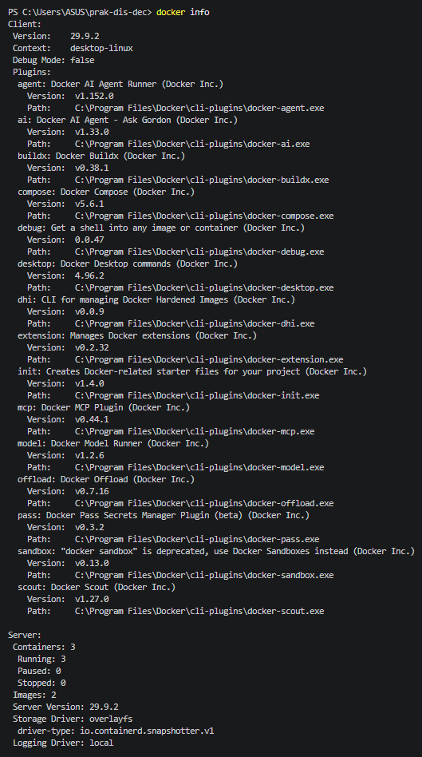

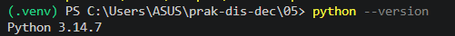

### 4.2 Membuat Virtual Environment

Folder kerja dibuat pada direktori `workspace-05`. Virtual environment dibuat
agar dependency praktikum terisolasi dari instalasi Python global. Setelah
environment aktif, BlackSheep dan CLI-nya dipasang menggunakan `uv`.

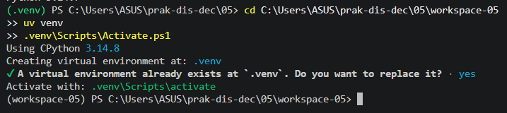


### 4.3 Membuat dan Menjalankan Aplikasi BlackSheep

Aplikasi dibuat menggunakan template bawaan BlackSheep. Dependency project
kemudian dipasang dari `requirements.txt`. Aplikasi dijalankan secara lokal
melalui `dev.py` pada port `44777`.

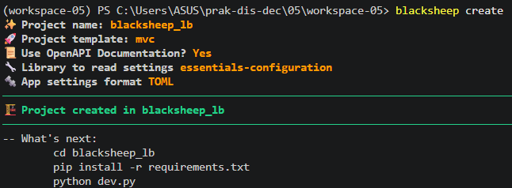

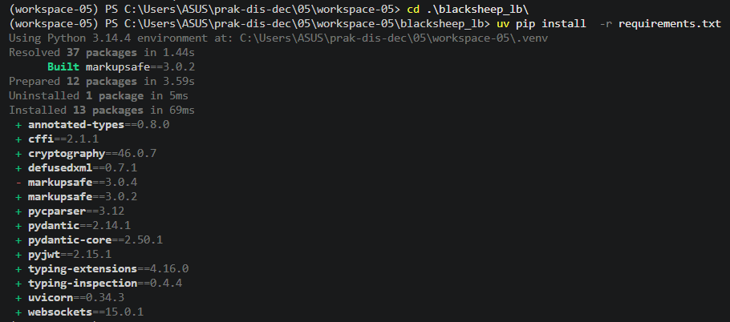

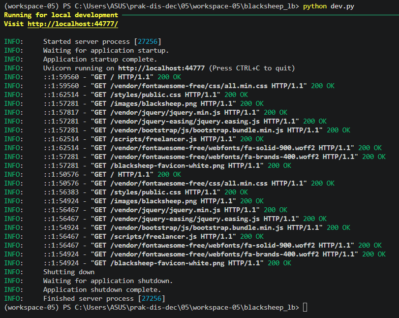

Hasil pengujian melalui browser menunjukkan halaman default BlackSheep berhasil
ditampilkan pada `http://localhost:44777`. Hal ini membuktikan aplikasi dapat
berjalan sebelum dimasukkan ke container.

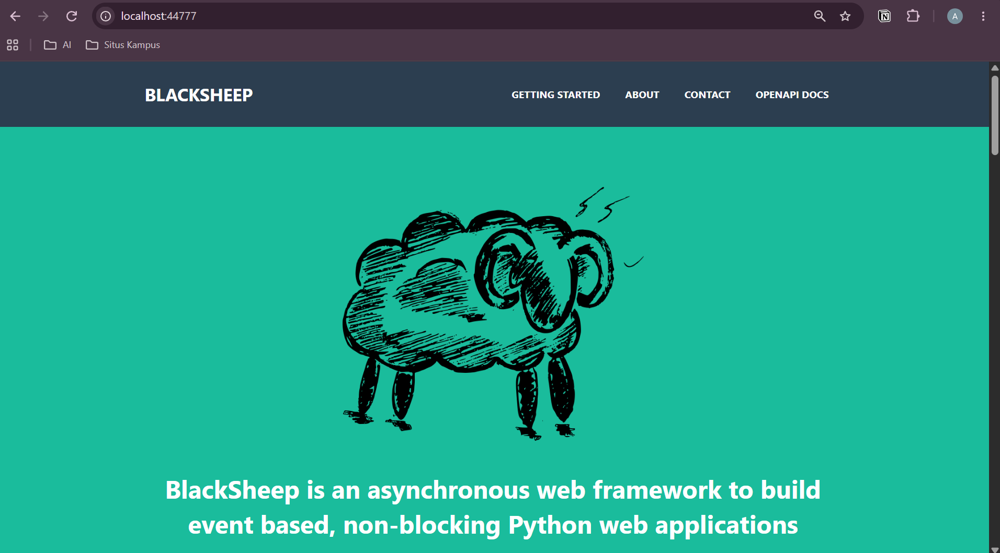

### 4.4 Menyiapkan Dockerfile Aplikasi

Image aplikasi disiapkan pada
[`blacksheep_lb/Dockerfile`](workspace-05/blacksheep_lb/Dockerfile). Dockerfile
menggunakan dua tahap build. Tahap pertama memasang dependency dan membuat
virtual environment, sedangkan tahap kedua menyalin hasil build dan menjalankan
Uvicorn pada alamat `0.0.0.0:80`.

Pada hasil praktikum, base image yang digunakan adalah `python:3.13.1-slim`.
Port container dibuat `80`, sehingga port internal ini berbeda dengan port
pengembangan lokal `44777`.

### 4.5 Menyiapkan Nginx sebagai Load Balancer

Nginx dibuat pada [`nginx/Dockerfile`](workspace-05/nginx/Dockerfile) dan
konfigurasinya ditulis pada [`nginx/nginx.conf`](workspace-05/nginx/nginx.conf).
Konfigurasi tersebut:

- mendefinisikan `worker_connections` sebanyak 4096;
- membuat upstream bernama `backend`;
- mengarahkan upstream ke service Docker `bs_app` pada port 80;
- meneruskan request dari Nginx ke upstream melalui `proxy_pass`.

Konfigurasi Docker Compose terdapat pada
[`docker-compose.yml`](workspace-05/docker-compose.yml). Service `bs_app`
dibangun dari folder aplikasi, sedangkan service `nginx` dibangun dari folder
Nginx dan mempublikasikan port host `80` ke port container `80`.

### 4.6 Menjalankan Dua Instance Aplikasi

Perintah berikut digunakan untuk membangun image, menjalankan service secara
detached, dan melakukan scaling aplikasi menjadi dua instance:

```powershell
docker compose up --build -d --scale bs_app=2
```

Hasil build menunjukkan image aplikasi dan Nginx berhasil dibuat. Dua instance
aplikasi kemudian dijalankan sebagai `bs_app-1` dan `bs_app-2`.

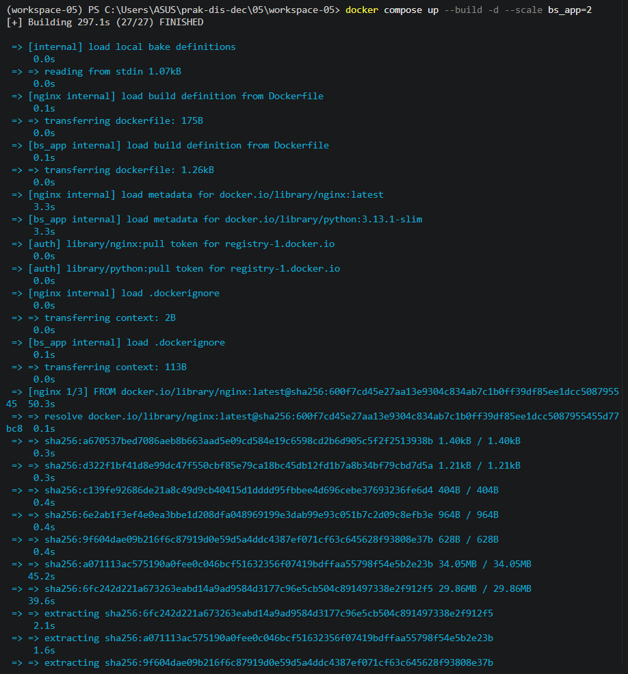

Client mengakses aplikasi melalui `http://localhost`, bukan lagi melalui port
`44777`. Port 80 diterima Nginx lalu diteruskan ke salah satu instance aplikasi.

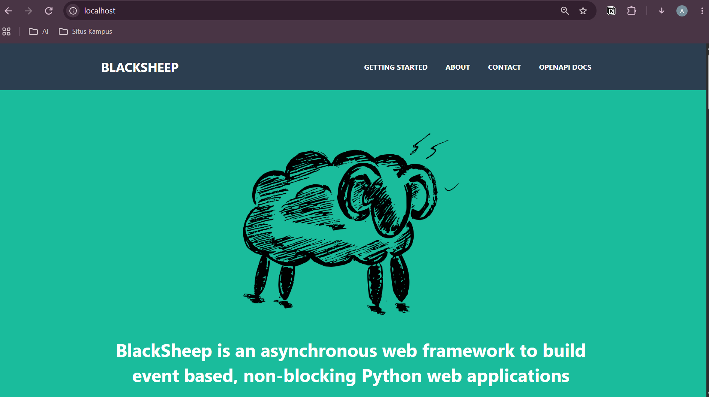

### 4.7 Memverifikasi Load Balancing

Pemeriksaan dilakukan dengan melihat log service aplikasi. Log menunjukkan
`bs_app-1` dan `bs_app-2` sama-sama menjalankan Uvicorn pada port 80 dan sama-sama
menerima request HTTP dengan status `200 OK`. Hal ini menjadi bukti bahwa request
yang masuk melalui Nginx dapat diteruskan ke lebih dari satu instance.

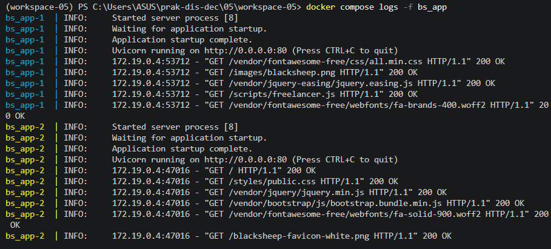

Setelah pengujian selesai, seluruh container dihentikan menggunakan:

```powershell
docker compose down
```

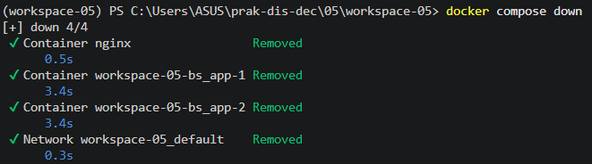

### 4.8 Menguji Failure Detection dengan Heartbeat

Script [`check-server.py`](workspace-05/blacksheep_lb/check-server.py) memakai
socket TCP untuk memeriksa koneksi ke host dan port yang diberikan sebagai
argumen. Pengujian dilakukan pada port `44777` saat aplikasi aktif dan saat
aplikasi tidak aktif:

```powershell
python check-server.py localhost 44777
python check-server.py localhost 80
```

Saat aplikasi pengembangan aktif di port `44777`, output yang diperoleh adalah
`Server up`. Ketika tidak ada aplikasi yang menerima koneksi pada port tersebut,
output menjadi `Server down`. Port 80 juga digunakan sebagai pembanding setelah
layanan lokal pada port 44777 dihentikan.

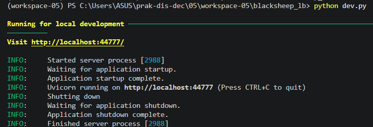

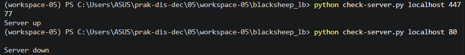

Perbedaan output terjadi karena socket hanya dapat terhubung apabila terdapat
proses server yang sedang listen pada port tujuan. Script ini merupakan bentuk
heartbeat atau health check paling sederhana: keberhasilan koneksi dianggap
sebagai tanda komponen aktif.

### 4.9 Menguji Retry

Script [`check-retry.py`](workspace-05/failure-detection/check-retry.py)
mengakses `http://localhost:44777`. Request dicoba hingga lima kali. Jika
request gagal, script menunggu sebelum mencoba kembali. Pada kondisi aplikasi
tidak aktif, seluruh percobaan gagal dan script akhirnya menampilkan pesan bahwa
URL tidak dapat diakses setelah beberapa kali retry.

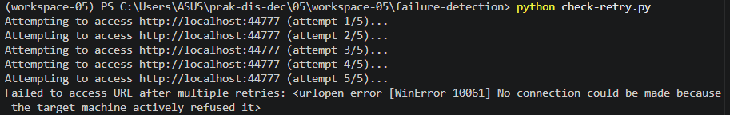

Pada kondisi aplikasi aktif, request berhasil dan isi halaman dapat diterima
tanpa perlu menghabiskan seluruh percobaan. Dengan demikian, retry sesuai untuk
gangguan sementara, tetapi tetap menghasilkan kegagalan setelah batas percobaan
terlampaui jika service benar-benar mati.

### 4.10 Menguji Circuit Breaker

Script [`check-circuit-breaker.py`](workspace-05/failure-detection/check-circuit-breaker.py)
menggunakan library `pybreaker` dengan konfigurasi:

```python
pybreaker.CircuitBreaker(fail_max=4, reset_timeout=20)
```

Artinya, setelah empat kegagalan, circuit breaker membuka sirkuit dan
menunggu 20 detik sebelum memberikan kesempatan pengujian kembali. Saat aplikasi
tidak aktif, request menghasilkan `ConnectionError`. Saat aplikasi aktif,
request berhasil dan output menunjukkan `Successfully accessed
http://localhost:44777`.

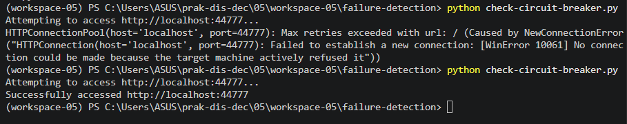

## 5. Hasil Praktikum

| No. | Pengujian | Hasil yang Terverifikasi |
| --- | --- | --- |
| 1 | Pemeriksaan Docker dan Python | Docker serta Python tersedia dan dapat digunakan. |
| 2 | Virtual environment | Environment khusus `workspace-05` berhasil dibuat. |
| 3 | Instalasi dependency | BlackSheep, CLI, dan dependency project berhasil dipasang. |
| 4 | Aplikasi lokal | Halaman default BlackSheep tampil pada `localhost:44777`. |
| 5 | Build container | Image aplikasi dan Nginx berhasil dibangun dengan Docker Compose. |
| 6 | Scaling aplikasi | Dua instance `bs_app-1` dan `bs_app-2` berhasil dijalankan. |
| 7 | Proxy Nginx | Aplikasi dapat diakses melalui `http://localhost` pada port 80. |
| 8 | Load balancing | Log kedua instance menunjukkan request berhasil dengan status `200 OK`. |
| 9 | Failure detection | Server aktif menghasilkan `Server up`, sedangkan port yang tidak melayani menghasilkan `Server down`. |
| 10 | Retry | Request yang gagal dicoba lima kali sebelum dinyatakan gagal. |
| 11 | Circuit breaker | Koneksi gagal saat service mati dan berhasil saat service aktif. |

## 6. Analisis

Konfigurasi praktikum membagi sistem menjadi client, Nginx, dan aplikasi
BlackSheep. Client tidak perlu mengetahui alamat setiap instance karena hanya
berkomunikasi dengan Nginx. Nginx menggunakan nama service `bs_app`, sedangkan
Docker Compose menyediakan dua container hasil scaling. Log menunjukkan kedua
container aktif dan menerima request, sehingga tujuan dasar load balancing dan
peningkatan availability berhasil dicapai.

Perbedaan port menunjukkan pemisahan antara lingkungan pengembangan dan
lingkungan container. Aplikasi lokal menggunakan port `44777`, sedangkan
Uvicorn di dalam container menggunakan port `80`. Nginx juga menerima koneksi
pada port 80. Karena itu, URL pengujian harus disesuaikan dengan komponen yang
sedang diuji: `localhost:44777` untuk aplikasi lokal dan `localhost` untuk
endpoint Nginx.

Failure detection, retry, dan circuit breaker menyelesaikan masalah yang
berbeda. Failure detection hanya memberi informasi apakah endpoint dapat
dihubungi. Retry memberi kesempatan pada layanan untuk pulih dari gangguan
sementara. Circuit breaker membatasi request ketika kegagalan terus berulang,
sehingga client tidak terus membebani layanan yang bermasalah dan sumber daya
sistem dapat dihemat.

Hasil praktikum juga menunjukkan bahwa load balancing bukan berarti setiap
request pasti dibagi dengan jumlah yang sama. Distribusi request dipengaruhi
algoritma proxy, jumlah request, dan waktu pengujian. Bukti yang penting adalah
lebih dari satu instance aktif dan request dapat diproses oleh kedua instance,
bukan kesamaan jumlah log secara mutlak.

## 7. Kendala dan Solusi

| Kendala yang Ditemukan | Solusi atau Pemahaman yang Diperoleh |
| --- | --- |
| Port aplikasi lokal berbeda dengan port container. | Menggunakan port `44777` untuk pengujian lokal dan port 80 untuk akses melalui Nginx. |
| Aplikasi harus dijalankan lebih dari satu instance. | Menggunakan `docker compose up --build -d --scale bs_app=2`. |
| Nginx tidak menjalankan aplikasi secara langsung. | Nginx dikonfigurasi sebagai reverse proxy ke service `bs_app`. |
| Status server tidak dapat diketahui hanya dari asumsi proses. | Memeriksa koneksi TCP dengan `check-server.py`. |
| Gangguan koneksi dapat bersifat sementara. | Menggunakan retry dengan batas lima percobaan dan jeda antarpercobaan. |
| Retry terus-menerus dapat membebani service yang gagal. | Menggunakan circuit breaker untuk membuka sirkuit setelah kegagalan mencapai ambang. |
| Versi Python pada modul dan Dockerfile dapat berbeda. | Mengikuti versi yang benar-benar tertulis pada Dockerfile dan mencatatnya sebagai bagian dari hasil praktikum. |

## 8. Kesimpulan

Praktikum Modul 5 berhasil menerapkan konsep fault tolerance melalui tiga
pendekatan. Pertama, load balancing dibuat dengan menjalankan dua instance
BlackSheep menggunakan Docker Compose dan menempatkan Nginx sebagai reverse
proxy. Kedua, failure detection diuji menggunakan koneksi socket dan
menghasilkan status berbeda antara server aktif dan server yang tidak aktif.
Ketiga, retry dan circuit breaker digunakan untuk mengelola kegagalan request
ke layanan eksternal.

Berdasarkan bukti praktikum, aplikasi BlackSheep dapat berjalan secara lokal,
berhasil dikontainerisasi, di-scale menjadi dua instance, dan diakses melalui
Nginx pada port 80. Pengujian script juga memperlihatkan bahwa retry memberikan
beberapa kesempatan koneksi, sedangkan circuit breaker menyediakan mekanisme
pemutusan sementara ketika kegagalan berulang. Kombinasi teknik tersebut
membantu sistem tetap tersedia dan mencegah kegagalan satu komponen menyebar ke
komponen lain.

## 9. Referensi

1. [BlackSheep Documentation](https://www.neoteroi.dev/blacksheep/)
2. [Docker Desktop for Windows](https://docs.docker.com/desktop/setup/install/windows-install/)
3. [Docker Compose Documentation](https://docs.docker.com/compose/)
4. [NGINX Documentation](https://docs.nginx.com/)
5. [Tenacity Documentation](https://tenacity.readthedocs.io/)
6. [PyBreaker Repository](https://github.com/danielfm/pybreaker)