# Laporan Praktikum Sistem Terdistribusi dan Terdesentralisasi

## Pertemuan 06: Instalasi Apache Hadoop dan Pengelolaan Data pada HDFS

### Identitas

- Nama: **Diana Amelia**
- NIM: **255410042**
- Kelas: **Informatika-1**

## 1. Tujuan

1. Memahami konsep dasar Apache Hadoop dan Hadoop Distributed File System
   (HDFS).
2. Menyiapkan Java dan Apache Hadoop pada lingkungan Ubuntu WSL2.
3. Mengonfigurasi environment variable dan file konfigurasi Hadoop.
4. Mengaktifkan komunikasi SSH untuk menjalankan daemon Hadoop secara lokal.
5. Memformat NameNode dan menjalankan layanan HDFS.
6. Membuat direktori pada HDFS dan mengunggah file CSV ke dalamnya.
7. Memeriksa isi, ukuran, dan status file yang tersimpan pada HDFS.
8. Menghentikan daemon Hadoop setelah praktikum selesai.

## 2. Dasar Teori

### 2.1 Apache Hadoop

Apache Hadoop adalah framework untuk menyimpan dan memproses data berukuran
besar secara terdistribusi. Hadoop membagi penyimpanan dan pemrosesan ke
beberapa komponen sehingga data dapat dikelola secara lebih skalabel.

### 2.2 Hadoop Distributed File System

HDFS adalah sistem file terdistribusi pada Hadoop. HDFS menggunakan NameNode
untuk menyimpan metadata file dan DataNode untuk menyimpan blok data. Dengan
model ini, file dapat disimpan pada lingkungan yang terdiri dari satu atau
lebih node.

### 2.3 NameNode, DataNode, dan YARN

- **NameNode** mengelola namespace, direktori, metadata, dan lokasi blok file.
- **DataNode** menyimpan blok data yang dikelola oleh NameNode.
- **YARN** mengelola sumber daya dan eksekusi aplikasi pada cluster Hadoop.
- **MapReduce** adalah framework pemrosesan data yang dapat berjalan di atas
  YARN.

Pada praktikum ini Hadoop dijalankan dalam mode lokal pada Ubuntu WSL2.
Walaupun hanya menggunakan satu komputer, konfigurasi tersebut tetap
memperlihatkan alur kerja komponen HDFS dan daemon Hadoop.

### 2.4 PdsH dan SSH

PdsH (Parallel Distributed Shell) dapat menjalankan perintah pada beberapa
host menggunakan mekanisme remote shell. Hadoop membutuhkan SSH agar script
seperti `start-dfs.sh` dapat menjalankan daemon pada host yang telah
ditentukan. Pada praktikum ini SSH dikonfigurasi untuk koneksi ke `localhost`.

## 3. Alat dan Bahan

- Komputer atau laptop dengan Windows.
- Ubuntu 26.04.1 pada WSL2.
- OpenJDK `17.0.20.1`.
- Apache Hadoop `3.5.0`.
- PdsH `2.35`.
- OpenSSH Server.
- Terminal Bash.
- Browser untuk mengakses Hadoop NameNode Web UI.
- Repository GitHub: [prak-dis-dec](https://github.com/dianaamelia24/prak-dis-dec).
- Source code dan bukti praktikum pada folder [06](../06/).
- Dataset `iris.csv`, `penguins.csv`, dan `tips.csv`.

## 4. Langkah Pengerjaan

### 4.1 Memeriksa Versi Java

Java diperiksa terlebih dahulu karena Hadoop membutuhkan Java Runtime
Environment. Perintah yang digunakan adalah:

```bash
java --version
```

Hasil pemeriksaan menunjukkan OpenJDK Runtime Environment dan OpenJDK 64-Bit
Server VM versi `17.0.20.1`, sehingga Java telah tersedia untuk menjalankan
Hadoop.

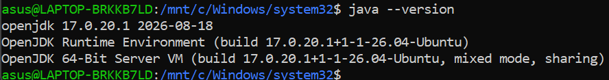

### 4.2 Mengunduh dan Mengekstrak Apache Hadoop

Paket Apache Hadoop `3.5.0` diunduh dari situs resmi Apache menggunakan
`wget`. File yang berhasil diunduh berukuran sekitar `555M`, kemudian
diekstrak ke home directory dan dibuat symbolic link bernama `hadoop`:

```bash
wget https://dlcdn.apache.org/hadoop/common/hadoop-3.5.0/hadoop-3.5.0.tar.gz
tar -xzf hadoop-3.5.0.tar.gz
ln -s hadoop-3.5.0 hadoop
```

Environment variable awal Hadoop kemudian ditambahkan ke `~/.bashrc`:

```bash
echo 'export HADOOP_HOME=$HOME/hadoop' >> ~/.bashrc
echo 'export PATH=$PATH:$HADOOP_HOME/bin:$HADOOP_HOME/sbin' >> ~/.bashrc
source ~/.bashrc
```

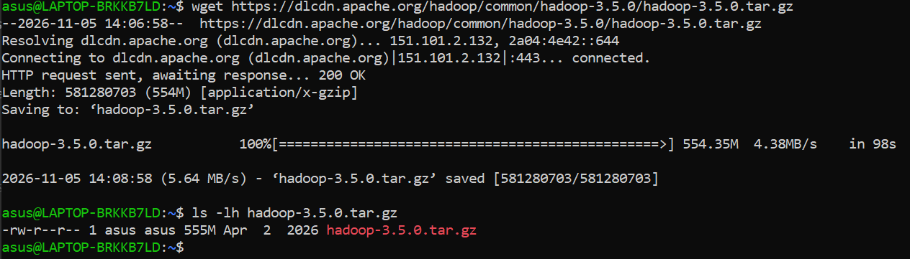

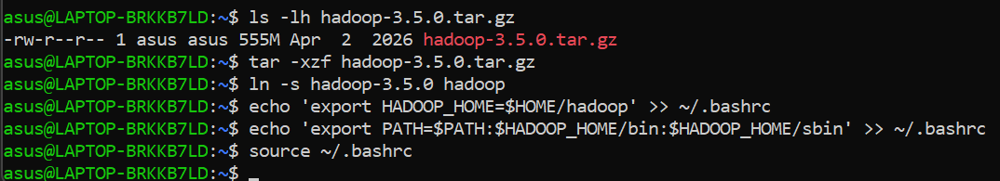

### 4.3 Memastikan Hadoop dan PdsH Tersedia

Perintah `hadoop` dijalankan untuk memastikan executable Hadoop dapat
dipanggil. Output menampilkan halaman penggunaan Hadoop beserta subcommand
administrasi dan client. Selain itu, versi PdsH diperiksa dengan:

```bash
hadoop
pdsh -V
```

PdsH yang digunakan adalah versi `2.35` dengan modul `ssh` sebagai remote
command module.

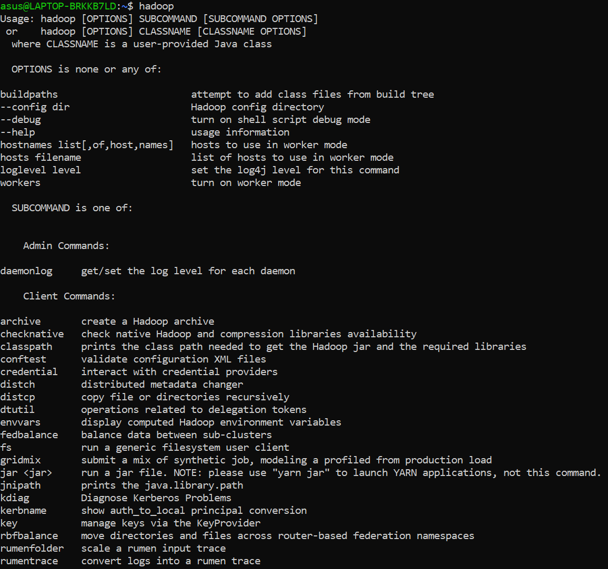

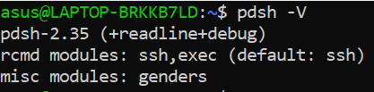

### 4.4 Mengatur PdsH dan Mengaktifkan SSH

Jenis remote command PdsH diatur menggunakan SSH:

```bash
export PDSH_RCMD_TYPE=ssh
echo 'export PDSH_RCMD_TYPE=ssh' >> ~/.bashrc
source ~/.bashrc
```

Layanan SSH kemudian dijalankan dan statusnya diperiksa. Bukti praktikum
menunjukkan `ssh.service` berada pada kondisi **active (running)** dan
mendengarkan pada port `22`.

```bash
sudo service ssh start
sudo service ssh status
```

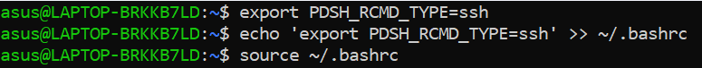

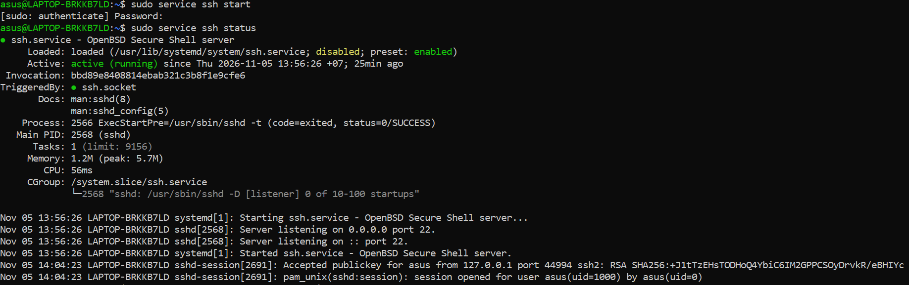

### 4.5 Membuat Kunci SSH Lokal

Kunci RSA dibuat untuk memungkinkan koneksi SSH ke host lokal tanpa
memasukkan password pada setiap pemanggilan:

```bash
ssh-keygen -t rsa -P '' -f ~/.ssh/id_rsa
cat ~/.ssh/id_rsa.pub >> ~/.ssh/authorized_keys
chmod 700 ~/.ssh
chmod 600 ~/.ssh/authorized_keys
chmod 600 ~/.ssh/id_rsa
ssh localhost
```

Koneksi ke `localhost` berhasil dan menampilkan informasi Ubuntu WSL2.


### 4.6 Mengonfigurasi HDFS

Konfigurasi dasar HDFS dilakukan pada file `hdfs-site.xml` dan `core-site.xml`.
Nilai `dfs.replication` diatur menjadi `1` karena praktikum dijalankan pada
satu lingkungan lokal. Pada `core-site.xml`, filesystem default diarahkan ke
NameNode lokal:

```xml
<property>
  <name>fs.defaultFS</name>
  <value>hdfs://localhost:9000</value>
</property>
```

Konfigurasi tersebut membuat perintah `hdfs dfs` menggunakan NameNode pada
`localhost:9000`.

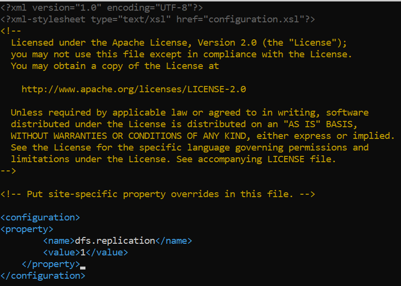

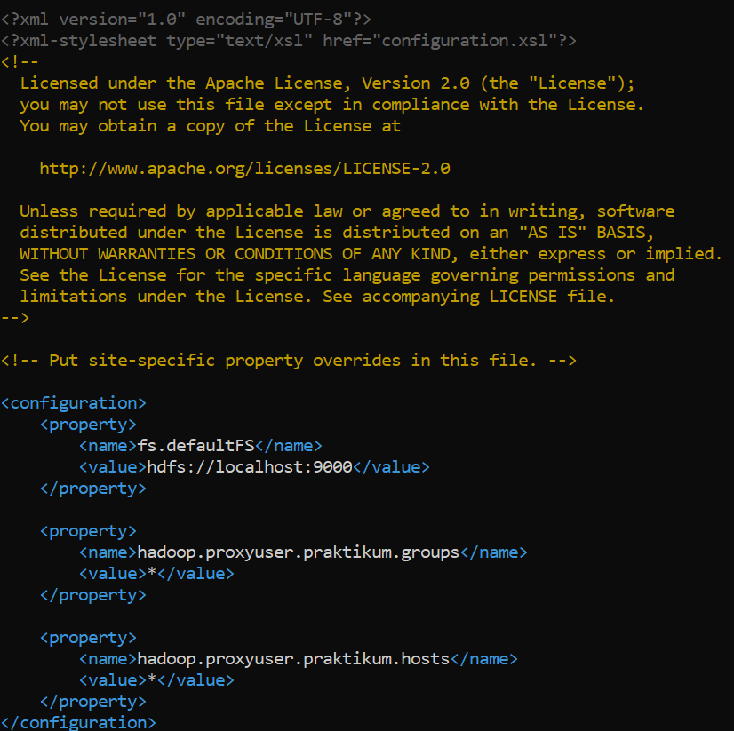

### 4.7 Mengonfigurasi MapReduce dan YARN

Pada `mapred-site.xml`, framework pemrosesan diatur menggunakan YARN dan
classpath MapReduce diarahkan ke library Hadoop. Pada `yarn-site.xml`
ditambahkan layanan shuffle MapReduce, daftar environment yang diperbolehkan,
serta pengaturan memori NodeManager.

Konfigurasi yang terlihat pada bukti meliputi:

- `mapreduce.framework.name` bernilai `yarn`;
- `yarn.nodemanager.aux-services` bernilai `mapreduce_shuffle`;
- memori NodeManager sebesar `4096 MB`;
- alokasi minimum scheduler sebesar `2048 MB`;
- rasio virtual memory sebesar `2.1`.

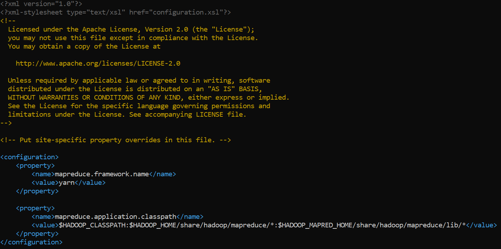

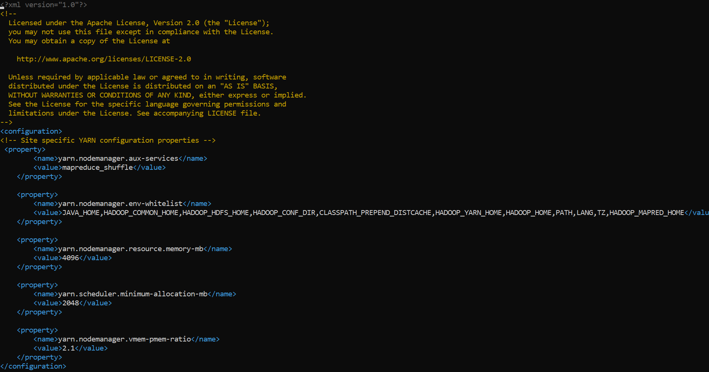

### 4.8 Mengatur JAVA_HOME pada Hadoop

Variabel `JAVA_HOME` diatur pada `hadoop-env.sh` agar script Hadoop mengetahui
lokasi instalasi Java:

```bash
export JAVA_HOME=/usr/lib/jvm/java-17-openjdk-amd64
```


### 4.9 Memformat NameNode

Sebelum daemon HDFS dijalankan, NameNode diformat menggunakan:

```bash
hdfs namenode -format
```

Output menunjukkan proses `Starting NameNode` dengan versi Hadoop `3.5.0`.
Peringatan mengenai folder log yang belum tersedia ditangani otomatis dengan
pembuatan folder tersebut.

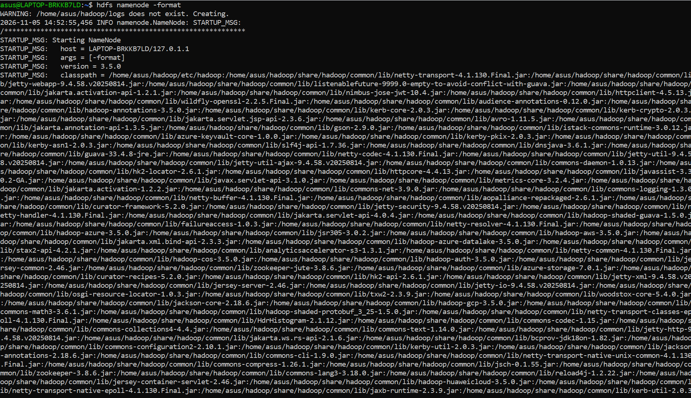

### 4.10 Menjalankan Daemon HDFS

Daemon HDFS dijalankan menggunakan:

```bash
start-dfs.sh
```

Output menunjukkan NameNode, DataNode, dan SecondaryNameNode mulai dijalankan.
Status HDFS kemudian dapat dipantau melalui Hadoop NameNode Web UI pada alamat
`http://localhost:9870/dfshealth.html`.

Web UI menampilkan status filesystem **active**, versi Hadoop `3.5.0`, serta
NameNode `localhost:9000`. Dengan demikian, layanan HDFS telah berhasil
berjalan.

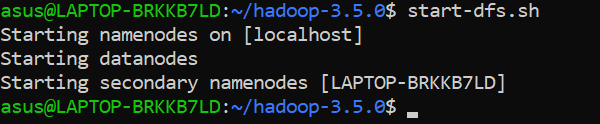

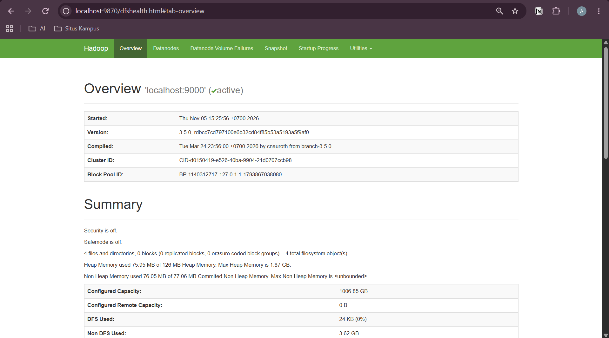

### 4.11 Membuat Direktori pada HDFS

Direktori untuk menyimpan dataset dibuat secara bertahap:

```bash
hdfs dfs -ls /
hdfs dfs -mkdir -p /user/asus
hdfs dfs -mkdir -p /user/asus/datasets
hdfs dfs -ls /user/asus
```

Hasil pemeriksaan menunjukkan direktori `/user/asus/datasets` berhasil dibuat
di dalam HDFS.

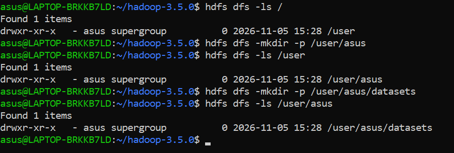

### 4.12 Mengunduh dan Memeriksa Dataset CSV

Tiga dataset CSV diunduh ke folder `~/datasets` menggunakan `curl`:

```bash
mkdir -p ~/datasets
cd ~/datasets
curl -fL -o iris.csv https://raw.githubusercontent.com/mwaskom/seaborn-data/master/iris.csv
curl -fL -o penguins.csv https://raw.githubusercontent.com/mwaskom/seaborn-data/master/penguins.csv
curl -fL -o tips.csv https://raw.githubusercontent.com/mwaskom/seaborn-data/master/tips.csv
```

Perintah `ls -lh` dan `head` memperlihatkan bahwa ketiga file telah tersimpan
dan memiliki format CSV yang dapat dibaca. Dataset tersebut berisi data iris,
penguins, dan tips.

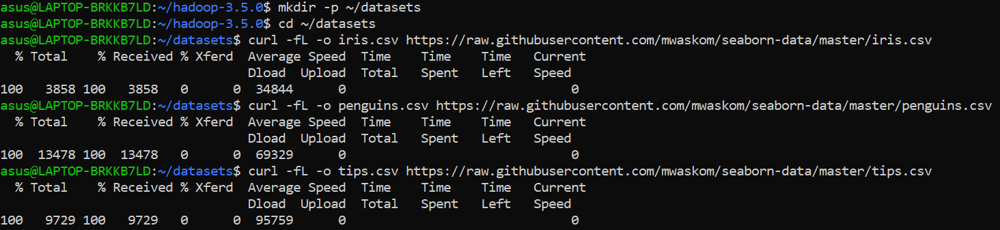

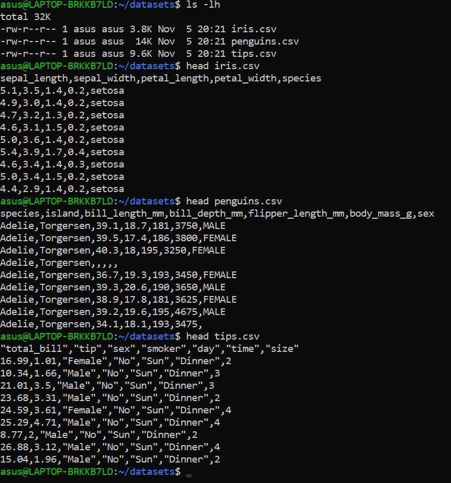

### 4.13 Memasukkan Dataset ke HDFS

Setiap file CSV disalin dari filesystem lokal ke direktori HDFS:

```bash
hdfs dfs -put ~/datasets/iris.csv /user/asus/datasets/
hdfs dfs -put ~/datasets/penguins.csv /user/asus/datasets/
hdfs dfs -put ~/datasets/tips.csv /user/asus/datasets/
hdfs dfs -ls /user/asus/datasets
```

Output `hdfs dfs -ls` menunjukkan tiga file berhasil tersimpan:

- `iris.csv` berukuran `3858` byte;
- `penguins.csv` berukuran `13478` byte;
- `tips.csv` berukuran `9729` byte.

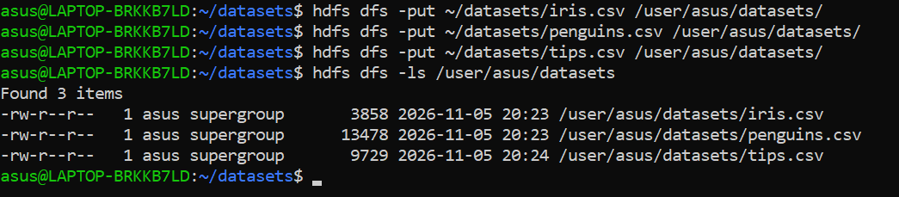

### 4.14 Memeriksa Isi dan Ukuran File pada HDFS

Isi file dibaca langsung dari HDFS menggunakan `hdfs dfs -cat` dan dibatasi
dengan `head`:

```bash
hdfs dfs -cat /user/asus/datasets/iris.csv | head
hdfs dfs -cat /user/asus/datasets/penguins.csv | head
hdfs dfs -cat /user/asus/datasets/tips.csv | head
```

Hasilnya menampilkan header dan beberapa baris dari setiap dataset. Ukuran
serta daftar file diperiksa kembali menggunakan:

```bash
hdfs dfs -du -h /user/asus/datasets
hdfs dfs -ls -R /user/asus
```

Pemeriksaan ini membuktikan bahwa data tidak hanya tercatat pada filesystem
lokal, tetapi dapat dibaca dari lokasi HDFS `/user/asus/datasets`.

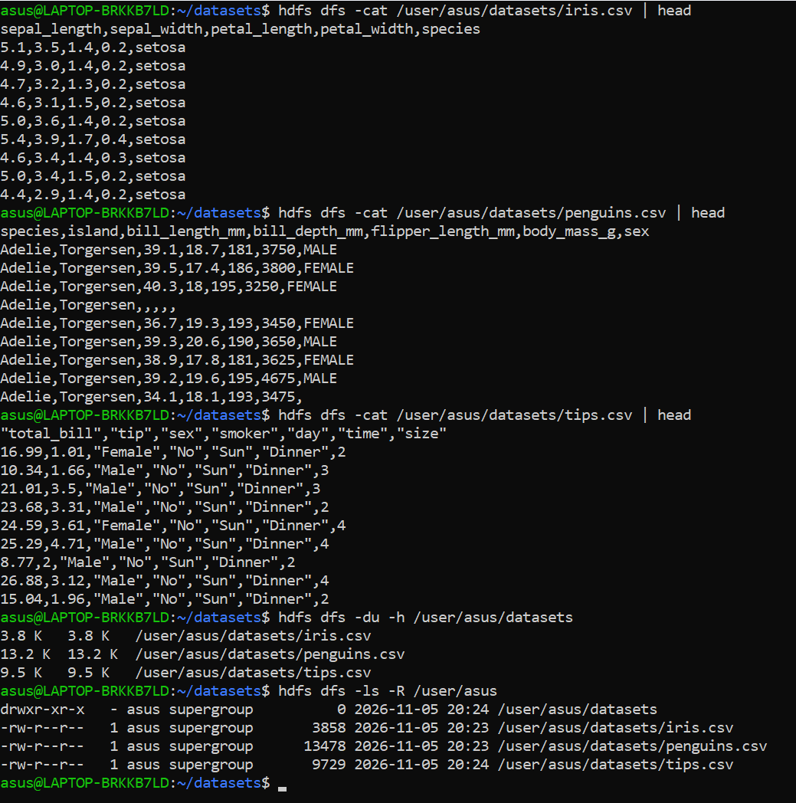

### 4.15 Menghentikan Hadoop

Setelah pengujian selesai, daemon HDFS dihentikan menggunakan:

```bash
stop-dfs.sh
jps
```

Output menunjukkan proses NameNode, DataNode, dan SecondaryNameNode dihentikan.
Perintah `jps` tidak lagi menampilkan daemon Hadoop, sehingga lingkungan
praktikum dapat ditutup dengan aman.

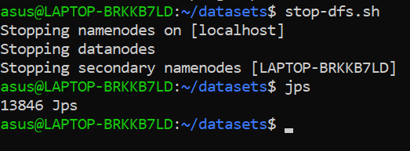

## 5. Hasil Praktikum

| No. | Tahap | Hasil yang Terlihat |
| --- | --- | --- |
| 1 | Pemeriksaan Java | OpenJDK `17.0.20.1` tersedia pada Ubuntu WSL2. |
| 2 | Instalasi Hadoop | Paket Apache Hadoop `3.5.0` berhasil diunduh dan diekstrak. |
| 3 | Pemeriksaan Hadoop | Perintah `hadoop` dapat dijalankan dan menampilkan usage. |
| 4 | PdsH | PdsH versi `2.35` tersedia dan dikonfigurasi menggunakan SSH. |
| 5 | SSH | `ssh.service` berstatus active/running pada port `22`. |
| 6 | HDFS | `dfs.replication` diatur `1` dan filesystem menggunakan `localhost:9000`. |
| 7 | MapReduce/YARN | Framework MapReduce dan layanan shuffle dikonfigurasi untuk YARN. |
| 8 | NameNode | Format NameNode berhasil dilakukan dengan Hadoop `3.5.0`. |
| 9 | Daemon | NameNode, DataNode, dan SecondaryNameNode berhasil dijalankan. |
| 10 | Web UI | NameNode Web UI aktif pada `localhost:9870`. |
| 11 | Direktori HDFS | `/user/asus/datasets` berhasil dibuat. |
| 12 | Dataset lokal | `iris.csv`, `penguins.csv`, dan `tips.csv` tersedia di `~/datasets`. |
| 13 | Upload HDFS | Tiga file CSV berhasil diunggah ke `/user/asus/datasets`. |
| 14 | Verifikasi data | Isi, ukuran, dan daftar file dapat dibaca melalui perintah HDFS. |
| 15 | Penghentian layanan | Daemon HDFS berhasil dihentikan dengan `stop-dfs.sh`. |

Seluruh bukti visual hasil praktikum disimpan pada direktori `06/images/`.

## 6. Analisis

Praktikum menunjukkan bahwa Hadoop tidak hanya terdiri dari proses instalasi
binary, tetapi juga memerlukan konfigurasi lingkungan dan layanan pendukung.
Java menjadi runtime utama, sedangkan `HADOOP_HOME` dan `PATH` membuat perintah
Hadoop dapat dipanggil dari terminal. PdsH dan SSH diperlukan agar script
pengelola daemon dapat menjalankan proses pada host yang dikonfigurasi.

Konfigurasi `fs.defaultFS` ke `hdfs://localhost:9000` menentukan NameNode yang
digunakan oleh client HDFS. Karena praktikum berjalan pada satu komputer,
replikasi diatur menjadi `1`. Pengaturan ini sesuai dengan mode lokal yang
digunakan, tetapi belum menunjukkan redundansi data seperti pada cluster
multi-node.

Setelah NameNode diformat, `start-dfs.sh` berhasil menjalankan komponen HDFS.
Keberhasilan akses ke Web UI pada port `9870` menjadi indikator bahwa NameNode
aktif. Direktori `/user/asus/datasets` juga menunjukkan bahwa HDFS dapat
digunakan seperti filesystem hierarkis.

Tiga file CSV berhasil dipindahkan menggunakan `hdfs dfs -put`. Perintah
`hdfs dfs -cat` kemudian membaca data dari HDFS, bukan dari folder lokal.
Dengan demikian, proses praktikum membuktikan alur dasar penyimpanan data:
menyiapkan dataset, membuat direktori HDFS, mengunggah file, memeriksa metadata,
dan membaca isi file.

Penghentian daemon menggunakan `stop-dfs.sh` penting dilakukan setelah
praktikum. Langkah ini mencegah proses Hadoop tetap berjalan dan memastikan
status lingkungan kembali bersih.

## 7. Kendala dan Solusi

| Kendala yang Ditemukan | Solusi atau Pemahaman yang Diperoleh |
| --- | --- |
| Hadoop membutuhkan Java yang sesuai. | Memeriksa `java --version` dan memastikan OpenJDK `17.0.20.1` tersedia. |
| Perintah Hadoop belum dapat dipanggil jika environment belum dimuat. | Menambahkan `HADOOP_HOME` serta `PATH` ke `~/.bashrc`, lalu menjalankan `source ~/.bashrc`. |
| Script Hadoop membutuhkan koneksi remote shell. | Menginstal/menjalankan SSH, mengatur PdsH ke tipe `ssh`, dan membuat kunci untuk `localhost`. |
| NameNode belum dapat digunakan sebelum memiliki metadata awal. | Menjalankan `hdfs namenode -format` sebelum `start-dfs.sh`. |
| Dataset masih berada pada filesystem lokal. | Menggunakan `hdfs dfs -put` untuk menyalin file ke `/user/asus/datasets`. |
| Perlu memastikan file benar-benar tersimpan pada HDFS. | Memeriksa dengan `hdfs dfs -ls`, `hdfs dfs -du`, dan `hdfs dfs -cat`. |
| Proses Hadoop tetap aktif setelah pengujian. | Menjalankan `stop-dfs.sh` dan memeriksa proses menggunakan `jps`. |

## 8. Kesimpulan

Praktikum pertemuan keenam berhasil mengonfigurasi Apache Hadoop `3.5.0`
pada Ubuntu WSL2 dengan Java OpenJDK `17.0.20.1`. Environment variable,
PdsH, SSH, HDFS, MapReduce, dan YARN berhasil disiapkan sesuai kebutuhan
mode lokal.

NameNode berhasil diformat dan daemon HDFS berhasil dijalankan. HDFS dapat
diakses melalui `localhost:9870`, direktori `/user/asus/datasets` berhasil
dibuat, dan tiga dataset CSV berhasil diunggah serta dibaca kembali dari HDFS.
Setelah verifikasi selesai, seluruh daemon Hadoop berhasil dihentikan.

Hasil ini membuktikan alur dasar pengelolaan data pada HDFS, mulai dari
menyiapkan lingkungan, menjalankan layanan penyimpanan terdistribusi,
memasukkan data, memverifikasi data, hingga menghentikan layanan.

## 9. Referensi

1. [Apache Hadoop Documentation](https://hadoop.apache.org/docs/)
2. [Apache Hadoop HDFS Architecture](https://hadoop.apache.org/docs/stable/hadoop-project-dist/hadoop-hdfs/HdfsDesign.html)
3. [Apache Hadoop YARN](https://hadoop.apache.org/docs/stable/hadoop-yarn/hadoop-yarn-site/YARN.html)
4. [Seaborn Example Data](https://github.com/mwaskom/seaborn-data)